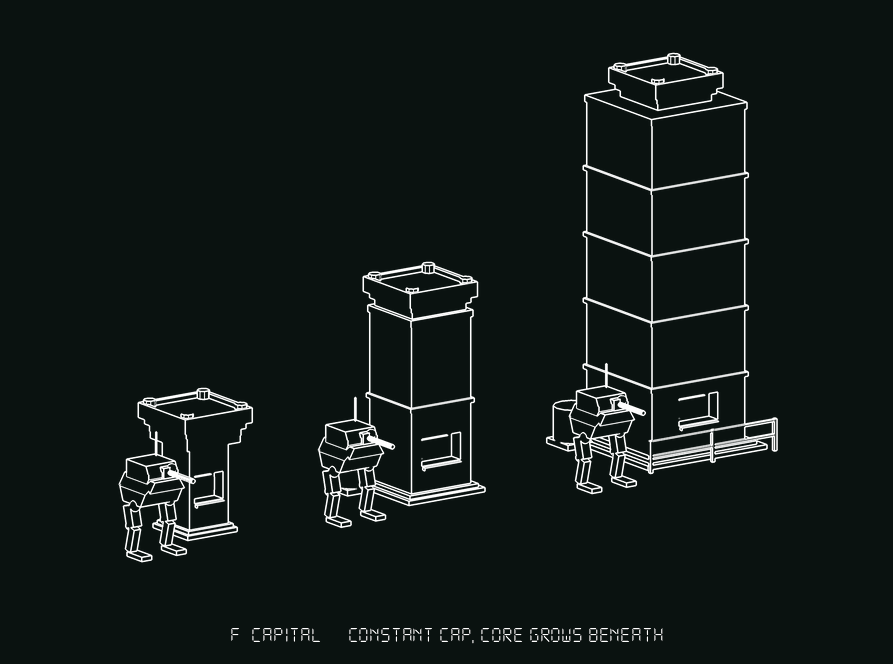
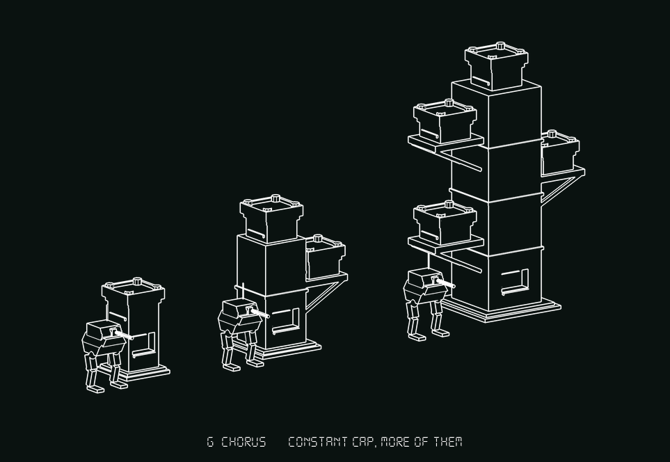
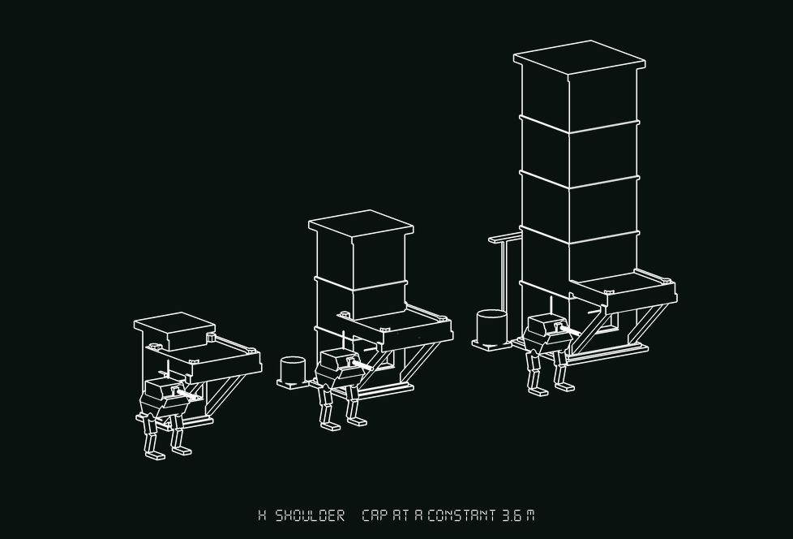
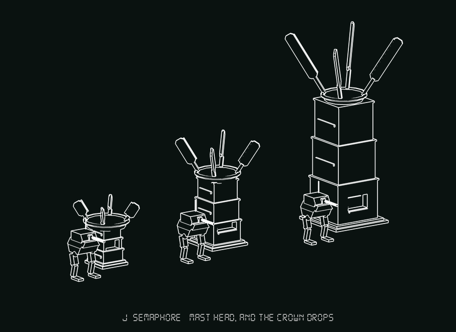
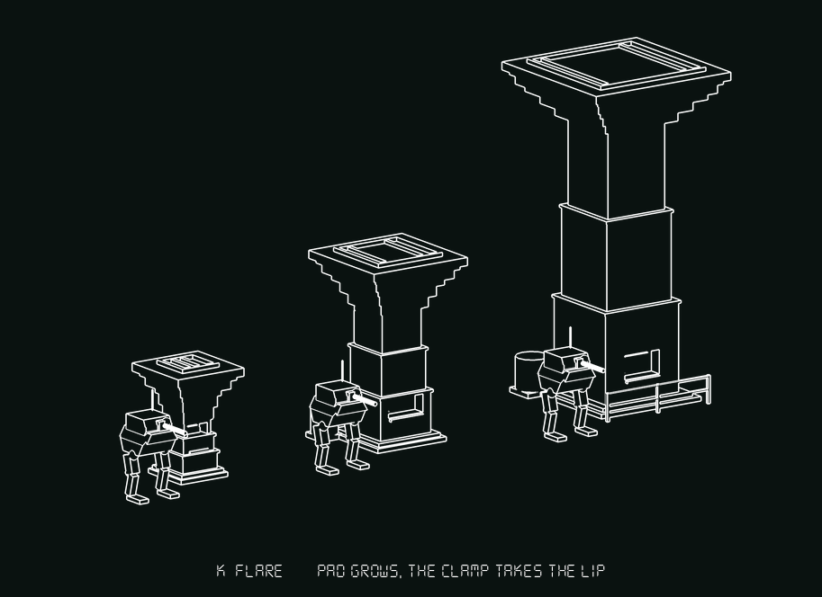

# COMPUTE CORE — concept round two, with the drone on top

Five new concepts, three sizes each · **status: concepts drawn, nothing
selected**

Sheets: `compute_cores_2.png` (all five plus the drone row), `core2_f.png` …
`core2_k.png` one row each, and **`core2_tick.png` — TICK seated on the medium
of all five in one photograph**. Builders: `tools/concepts_core2.gd`. Renderer:
`tools/shoot_cores2.gd`.

Round one is `COMPUTE_CORES.md` / `compute_cores.png` and nothing here repeats
it: A cassette stack, B mast and desk, C unit/machine/installation, D
block/slot/court, E pylon and apron. Its finding stands and is the reason this
round exists in the first place — the shipped trio is one form scaled, so a
12.4 m core reads as a 4.2 m core standing closer.

---

## 0. What changed, and what every concept here has to answer

Round one designed for **one** interface. There are now two.

**1. A face at ground level.** Unchanged, and still disqualifying.
`InteractRaycast` is 2 m, masks the Interactible layer only, and does not fire
when it starts inside the volume — so reach is the core's own footprint and not
a metre more. Every builder carries the same `_console()` on its −Z face with
the lit plate centred at y 1.55 and a kick rail under it, and on every sheet the
Walker is stood at that face. If there is nowhere for that figure to stand, the
concept is out.

**2. A cap something clamps onto.** New. The human has chosen **TICK**
(`HACK_DRONE.md`, `hack_tick.png`): a Swarm quad that flies in carrying
nothing — it *is* the payload — settles on the cap, clamps four barbed legs over
it, and lets its rotors droop dead. Measured **4.08 × 3.25 × 4.17 in flight,
3.23 × 3.17 × 3.28 placed**, with the barbs reaching **1.82 m out from the axis
and 1.67 m down**. `ConceptsHack.tick_placed` is built with the barb tips at
y 0, so seating it anywhere is one translation — which is why this round can
*show* the pairing instead of asserting it.

### The three measured facts that drove every design

Read off `maps/blocks/compute/compute_core*.map` at 32 units/m:

| | small | medium | large |
|---|---|---|---|
| overall | 1.88 × **4.19** × 1.88 | 3.38 × **6.97** × 3.38 | 5.19 × **12.38** × 5.19 |
| top column, across | **1.25** | **1.875** | **3.00** |
| cap low lip / apex, y | 2.97 / 3.81 | 5.56 / 6.59 | 10.22 / 12.00 |

**a. The landing pad varies 2.4×.** A clamp sized for one is wrong on the
others, and "scale the prop" is not available because the Tick is one object.

**b. The cap is cut at about 30°, so anything flat-bottomed rocks.** Every cap
in this round is **level**. That is a deliberate break with the shipped form:
the slope is a fault for this mechanic, not a style, and the four-independent-
jacks answer belongs to the drone, not to the building.

**c. The only square, level pair on the whole core is the two front corner
posts** — which is an accident the hack sheet had to go looking for. Four of the
five concepts here replace it with **lugs**: a designed interface, put there for
the thing that lands.

**d. And one from looking at `hack_tick.png`: on the 12.4 m core the Tick is
about forty pixels of clutter at the top of a tower.** It reads at 4.2 m and
nearly disappears at 12.4. Every section below says what it does about that,
including the two that say "nothing".

### One drawing rule that shaped all five

**A bored hole draws identically to a flat face at `fill = 0`**, which is what
nearly killed the Yoke. So no cap here is a socket *by being a hole*. Every one
of them breaks its own outline with a kerb, a lip or lugs standing proud —
three silhouette breaks, none of which depends on a bore surviving the
photograph.

### Method

Every number below is a **measured** bounding box printed by
`shoot_cores2._bounds_of`, with subtraction shapes excluded, not an estimate.
A row is **one photograph with one camera**, so within a row the three sizes are
at true common scale; rows do not share a scale with each other, and the
3.81 m Walker is the only thing that carries across. All fifteen land on
4.20 / 7.00 / 12.40 exactly — none of these concepts argues for a different
height, and the four that wanted to are noted where they wanted to.

---

## 1. F — CAPITAL · **the constant-cap position**

Measured **2.60 × 4.20 × 2.60** · **3.89 × 7.00 × 3.09** · **6.08 × 12.40 ×
4.97**.

**One pad, 2.60 m square, at every size.** A deck with a lit slot under it, a
kerb round it and four lugs at its corners, carried on a corbel, with the shaft
growing underneath — 1.5, 2.3 and 3.6 m across. The cap is `F_PAD` and it is
written in the file as a ruler that must never be scaled.

**The two interfaces.** The console is cut into the shaft at the usual band, in
the open, with the full footprint to stand at. The cap is a flat lugged deck
2.60 across, which puts the Tick's barbs 0.52 m outside the deck edge and down
the corbel — a straddle, the same grip the hack sheet's seated renders show.

**The 2.4× problem: deleted.** This is the whole concept. One pad means one
clamp angle, one animation, one collision shape on the drone's side, and the
hack reads identically on a 4.2 m core and a 12.4 m one.

**Did the constant-cap position work? Yes — and it works for a reason that says
why round one's B failed.** B bolted a fixed-size console to the *bottom* of a
scaled mast and photographed as a bus shelter at 4.2 m and as an invisible
detail at 12.4, because a constant-size cue standing in front of a thing says
"far away" at least as loudly as it says "big". **A cap does not have that
ambiguity, because it is a terminator rather than a neighbour.** The eye
compares the cap's width to the shaft's width *directly, in the same part of the
picture, at the same depth* — and on `core2_f.png` the comparison is unmissable:
on the small core the cap overhangs the shaft by half a metre each side and
reads as a capital on a stump; on the large the shaft is wider than the cap and
the cap reads as a chimney head. Cover the Walkers and the three are still
obviously three sizes. That is more than round one's A (which needs you to
count) or B (which needs the ground plane) managed.

**What it costs.** Almost nothing. It is one parametric builder with two
arguments, one collision profile, one nav footprint. It is the cheapest thing in
either round after A, and unlike A it is a shape change rather than a count
change.

**The honest weakness.** *It does nothing whatever about fact (d).* The Tick on
F-medium measures 3.89 × **9.61** × 3.28 — the drone adds 2.6 m to a 7 m core
and dominates it. On the large it would be the same 3.2 m object on a 12.4 m
tower, which is the forty-pixel problem unchanged. F fixes the *fit* and ignores
the *read*. Second, and smaller: a constant cap means a constant **approach
clearance over the top**, so the flight path in is the same on all three — which
is good — but it also means the large core's silhouette is top-light, and a
heavy shaft with a small hat is a water tower if the dressing goes wrong.

*Rejected inside this concept:* holding the shaft constant too, so only height
changed. That is round one's photograph again, on purpose, and it fails for the
same reason.

---

## 2. G — CHORUS · constant cap, and more of them

Measured **2.45 × 4.20 × 2.45** · **5.21 × 7.00 × 3.31** · **8.51 × 12.40 ×
4.32**.

F's answer with the second half of the thought added: **if the pad cannot grow,
let the count grow.** One head at 4.2 m, two at 7.0, four at 12.4 — each an
identical 2.10 m lugged pad on its own louvred body, the top one on the trunk
and the rest on raking brackets off alternate sides, at 5.2, 7.7 and 10.1 m.

**The two interfaces.** Console on the trunk, in the open, unchanged. Four caps,
all the same, all level, all lugged.

**The 2.4× problem: deleted, same as F** — and then used. Three things fall out
and they are the concept:

- **The Tick stops vanishing.** The large core's lowest head is at 5.2 m, which
  is Walker eye level. On a 12.4 m tower there is a drone-sized object within
  four metres of the ground, so the eye gets the *tower's* scale from the thing
  clamped to it rather than the other way round. This is the only concept that
  answers fact (d) without changing the core's silhouette language.
- **A core can be partly taken.** Four heads is four hacks. A core with two
  Ticks on it and two bare pads is a readable mid-state, visible from outside,
  with no UI. Nothing else on either sheet can say anything at all about
  progress.
- **The silhouette is asymmetric**, which is the one property that survives
  200 m and bad light.

**What it costs.** Width: **8.51 m across the large**, against 5.19 shipped.
That is the price of hanging 2.1 m heads off a 3.0 m trunk and clearing it, and
it is a real placement cost — not E-large's 16 m apron, but no longer a thing
you put in a street. It is also two builders rather than one (head, bracket),
and the brackets are structure that has to be brushed and not just drawn.

**The honest weakness.** *Four heads may be four objectives.* If each pad is
hackable the mission designer has gained a dial and the player has gained a
chore, and nothing in the current objective script knows what a partly-taken
core is — this concept writes a cheque the code has not agreed to. If the answer
is "one hack takes the whole core", three of the four pads are decoration and G
collapses into a more expensive F. Second: a trunk with things on brackets at
four heights is **one dressing mistake away from a candelabra**, and the sheet is
closer to that than I would like at the large size.

---

## 3. H — SHOULDER · the cap comes down to the player

Measured **3.60 × 4.20 × 4.90** · **5.20 × 7.00 × 6.45** · **6.84 × 12.40 ×
7.37**.

Every other concept in both rounds puts the landing pad at the top because that
is where tops are. **H asks why.** The pad is a terrace thrown forward off the
tower's front face with its lug tops at a constant **3.6 m above ground** on all
three sizes, cut 0.38 m into the tower and carried on two raking struts down to
the plinth. The tower grows *above and behind* it.

**The two interfaces, and this is the point: they are the same bay.** The
console is on the tower's own front face, **under the terrace** — a covered
porch. The player walks in, stands under four square metres of deck, and presses
the key with the Tick clamped two metres over his head. At every size. The same
two metres.

**The 2.4× problem: deleted**, by a 3.40 m deck that never changes.

**Fact (d) — the Tick vanishing — is answered outright, and this is the only
concept that answers it completely.** The drone is never further from the player
on a 12.4 m core than on a 4.2 m one, because the drone is not on the 12.4 m
part. The seated render measures 5.20 × **7.00** × 6.75 — the Tick does not add
to the medium core's height *at all*; it is inside the silhouette, at eye level,
where it can be looked at and shot at.

**What it costs.** Depth: **7.37 m front to back on the large**, against 5.19
shipped, and all of it in front of the tower where the player's approach is. A
core in a corridor now needs a bay, which is round one's B's cost in a different
direction. And the terrace is a 3.6 m ledge with no stair, so it is a thing the
squad can see and not use, which will read as an oversight to anyone who tries.

**The honest weakness.** *The tower stops being part of the mechanic.*
Everything above 4 m is landmark — the hack never touches it, the player never
touches it, and a 12.4 m structure whose top eight metres exist to be seen from
far away is honest about being scenery in a way the other four are not. Second:
the first pass of this concept stood the terrace clear of the tower on four
vertical legs and **photographed as a trestle table parked beside a tower** —
furniture, not architecture. It took the overlap and the raking struts to fix,
and the fault is one step away at all times; a shoulder that does not visibly
grow out of the building is a table. Third, at 4.2 m the terrace is 86% of the
core's height and the tower is a 0.6 m stub above it, so the small one is a
canopy with a box on it.

---

## 4. J — SEMAPHORE · the hack is what you read, not the drone

Measured **3.30 × 4.20 × 3.30** · **4.14 × 7.00 × 4.14** · **5.67 × 12.40 ×
5.67**.

Everything above tries to make the *drone* visible on a big core. **J gives that
up and makes the *hack* visible instead.**

The cap is a mast head: a drum collar of constant radius **1.45 m** with a rolled
rim and four lugs inside it — 1.45 is the Tick's own number, because a barb lands
1.82 from the axis and therefore 0.37 m outside the rim and under the roll,
which is what gripping a ring means. Standing out of that ring are **four vanes**,
raised blades that *do* scale with the core: 1.3 m on the small, 2.4 on the
medium, **4.4 on the large**. They are a third of the large core's height and
they are the only part of it with any width.

**When the Tick clamps, the crown drops.** `j_ticked()` is the same builder with
one angle changed, from 58° above horizontal to 34° below it.

**The 2.4× problem: deleted** by the constant ring, exactly as F does it.

**Fact (d): sidestepped, and here is the measurement.** The live medium is
4.14 × 7.00 × 4.14. **The hacked medium, bare, is 5.05 × 4.84 × 5.05** — it has
lost **2.16 m of height, 31% of itself**, and gained 0.9 m of width. At 300 m you
cannot see a 3.2 m drone on a 12.4 m tower, but you can absolutely see that a
tower which had a four-point crown this morning does not have one now. **A hacked
core should look wrong from a distance, and this is the only concept in either
round where it does.**

**The honest weakness, and it is one the renderer found rather than one I
guessed.** *With the Tick actually on it, the core is not shorter.* The seated
render measures 5.05 × **7.37** × 5.05 — taller than the live 7.00, because the
drone has replaced the crown it dropped. The silhouette change is still large
and still legible (four raised blades become four hanging ones plus a lump), but
the clean "it lost two metres" reading only exists in the half-second between
the vanes falling and the drone settling, and from behind cover you may never
see it. Second: this is the only concept that puts a **state machine on the
building**. Every other core here is one static mesh; J is two, or one with a
driven bone, and that is a cost the TERRAIN lane pays forever. Third, the small
one is a bowl on a stump — at 4.2 m the ring and crown are half the object and
it reads as a brazier.

*Rejected:* vanes that fold *in* rather than drooping out. They vanished into
the drum and the hacked core just looked unfinished.

---

## 5. K — FLARE · let the pad grow, and grip the edge instead

Measured **2.88 × 4.20 × 2.88** · **4.34 × 7.00 × 4.08** · **5.88 × 12.40 ×
5.88**.

The straight opposite of F, and the only concept here that does not try to
defeat the 2.4× range. It says the range is only a problem **because everyone is
trying to grip the middle.**

A battered shaft opens out at the top into a flared head, corbelled out in three
steps, with a **lip standing 0.34 m proud of the head all the way round** and a
shallow kerbed dish inside it. The pad therefore scales freely — 2.2, 3.4 and
5.2 m across — and the clamp does not care, because what it grips is the lip,
and **the lip is the same section at every size. An edge interface is scale-free
by construction; a pad interface never is.**

**The two interfaces.** Console cut into whichever shaft stage contains the band
(the stages are short on the small core, so this is solved rather than assumed).
Cap: a rim, not a pad.

**Fact (d): not answered, and partly made worse** — but it buys something for
it. The Tick lands **off centre**, biting the lip, and the seated render is drawn
that way: 0.7 m out on a 1.7 m half-head, which puts the leading barbs past the
lip and the trailing ones on the deck. An off-centre load is a silhouette break,
and a crab gripping the edge of a table is a better picture than a crab centred
on a cathedral. But a 3.2 m drone on the edge of a 5.2 m head is still a 3.2 m
drone on a 12.4 m tower.

**What it costs.** The head overhangs: **5.88 m across the large with nothing
under the last 1.3 m of it**, which is a shape level designers have to leave air
for and a shape that will catch a squad's pathing if it is ever placed against a
wall. It is also the only concept whose footprint on the ground is much smaller
than its footprint in the air, which is a nav-bake conversation.

**The honest weakness.** *It reads as a monument.* On the sheet K is the
best-looking of the five by some distance and that is exactly the problem — a
flared capital on a battered shaft is a **fountain, a cooling tower, a war
memorial**, and this project has killed a design for that fault before (the
Picket tripod, and the Yoke's water-tower gallery). An objective has to read as
*plant*, and K is one dressing pass away from reading as *civic*. Second: the
large core's dish is 5.2 m across — a 3.2 m drone sitting on the rim of it leaves
most of a small courtyard empty, and "the cap is bigger than the thing that
lands on it" is a slightly embarrassing sentence for an interface design.

---

## 6. Where they disagree

| | the cap is | cap across | spans 1.25→3.00 by | Tick at 12.4 m | cost |
|---|---|---|---|---|---|
| **F** CAPITAL | a lugged pad, constant | 2.60 at all three | being constant | unanswered | lowest |
| **G** CHORUS | 1 / 2 / 4 lugged pads | 2.10 each | being constant | **answered** — a pad at 5.2 m | +brackets, 8.5 m wide |
| **H** SHOULDER | a terrace at 3.6 m | 3.40 at all three | being constant | **answered** — the pad never rises | +7.4 m of depth |
| **J** SEMAPHORE | a lugged mast ring | r 1.45 at all three | being constant | sidestepped — read the crown | +a second state |
| **K** FLARE | a lipped flare | 2.2 / 3.4 / 5.2 | **gripping the edge** | unanswered | +an overhang |

Four of the five converge on "make the cap constant", which was the brief's
suspicion and is now the sheet's finding: **it works, and it works better at the
top than round one's B managed at the bottom.** K is the dissent and its
argument is the better *engineering* — an edge interface is scale-free without
needing anything held constant at all — but it is the one that leaves the pad
oversized on the big core.

## 7. Ranking, and why

**1. G — CHORUS.** It takes the constant-cap position (so the clamp is one
number) and then gets three more things out of it that nothing else on either
sheet offers: a drone the player can see on a 12.4 m core, a core that can be
*partly* taken, and an asymmetric silhouette that survives range. It is three
forms by *count*, which costs two builders rather than three models. First on
the condition that somebody answers the question it raises — whether four pads
is four hacks — because if the answer is "no", G is a more expensive F and
should be dropped to third.

**2. H — SHOULDER.** The best single idea in the round: both interfaces in one
bay, the player standing underneath the clamp, the drone at eye level forever.
It is the only concept that makes the hack *legible at the range it happens at*
rather than at the range you steer by. Second rather than first because it
admits that the top two-thirds of a large core is scenery, because it eats 7.4 m
of the approach, and because the trestle-table failure is permanently one bad
dressing pass away.

**3. F — CAPITAL.** The honest minimum, and the thing I would build if this
round's verdict is "not now". Cheapest by a distance, one parametric builder,
and the constant-cap finding is genuinely positive — the three sizes read as
three sizes with the Walkers covered up. Third only because it answers the
fitting problem and not the reading problem, and the reading problem is the one
round one was convened about.

**4. K — FLARE.** The best-looking sheet and the most rigorous answer to fact
(a): grip the edge and the pad's width stops being a variable at all. Fourth
because its two faults are the expensive kind — it reads as civic architecture
rather than as plant, which is the fault that has killed two designs in this
project already, and its large head is a 5.2 m table with a 3.2 m drone perched
on the rim. **If the dressing can make it read as plant, this moves to second**,
because the edge-grip argument is the only one here that would still be correct
if the core sizes changed again.

**5. J — SEMAPHORE.** The strongest idea for the *mechanic* and the weakest
evidence. "A hacked core looks wrong from a kilometre" is the thing this game
most wants and nothing else here delivers — but the measurement says the core
only loses its 2.16 m once, and with the drone on it the height comes back.
It also puts a moving state on a building that is otherwise one baked mesh.
Last on the evidence; first if somebody wants the hack to be visible from across
the map badly enough to pay for a second state.

**What I cannot judge, and the human can.** Whether the player should *see the
drone* (G, H) or *see the damage* (J) is a question about what the hack is for,
and that is a feel question about a mechanic I cannot play. If the hack is a
thing you watch happen to your own core, H wins outright. If it is a thing you
spot across a valley and go and deal with, J does, and its costs are worth
paying.

## 8. Notes for whoever builds the selected one

- **Measure, do not estimate.** `tools/shoot_cores2.gd` prints every builder's
  real bounding box and the shipped scenes' alongside, with subtraction shapes
  excluded. Every number in this document came out of that run.
- **The renderer is a SIBLING of `shoot_cores.gd`, not an edit of it.** Round
  one's renderer is right and did not need changing; it hard-codes round one's
  builder file, it is committed work in a shared checkout, and re-pointing it
  would make round one's sheets unreproducible. Two things are different: a
  sixth row that seats TICK on all five mediums, and a reversed layout loop that
  is not hard-coded to three cells — the original's `for i in [2, 1, 0]` would
  have photographed the first three of five and looked like a complete picture.
- **Three faults found by looking, in the order they were found.**
  1. **`CSGPolygon3D` extrudes along its own NEGATIVE Z.** Measured: an
     unrotated `plate(0.36, 0.36, 0.26)` has AABB position z = −0.26. So the
     rotation that stands a lug up is Rx(**+**90); at Rx(−90) every lug extruded
     down through its own deck and drew as nothing, and the only symptom was
     every lugged concept measuring exactly 0.11 m short — the kerb height, i.e.
     the kerb had quietly become the top of the model.
  2. **`_console()`'s 1.55 m is a LOCAL height, and these bodies are centred on
     their own middles.** On a shaft whose centre sat at y 1.6 the "1.55 m"
     console came out at 3.15 and the Walker stood under it looking at a wall.
     `concepts_core2._console` takes a world height and warns if the band falls
     outside the body it is cutting. **Round one's cabinets and cassettes have
     the same offset in them** — worth a look if any of those builders is ever
     taken further.
  3. **A handrail is the tallest thing on anything short.** H's terrace rail
     topped out at 4.42 on a core quoted at 4.2. It is round one's own note
     (`_core_head`, `c_medium`) and it caught this round anyway.
- Nothing here touched `maps/`, any `.map`, `Env/world_objects/` or any
  objective script. The builders are a drawing of an intention; the brush work
  is the TERRAIN lane's.
- The sheets in this directory are documentation images, not game resources —
  they have no `.import` files, which is correct until someone opens the editor
  and does not matter either way.
