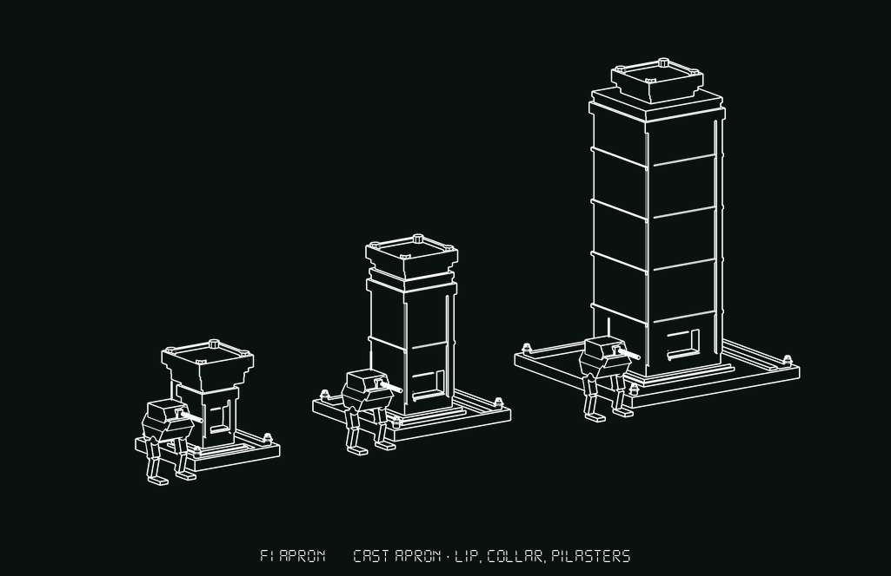
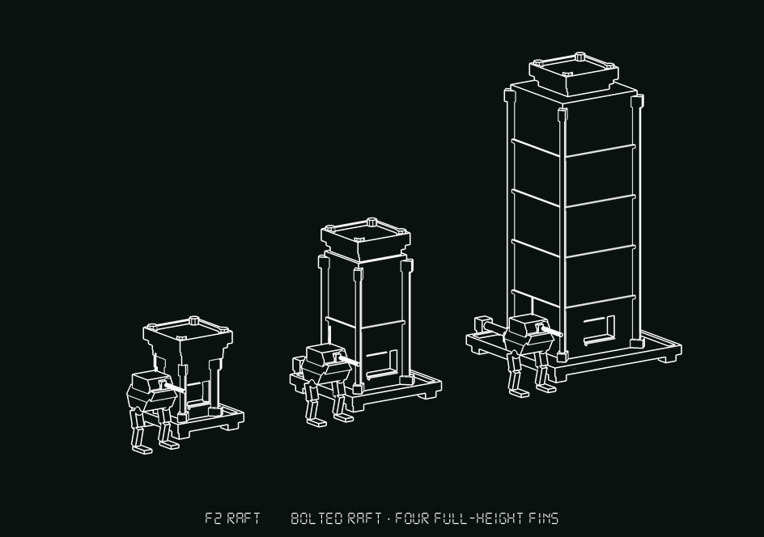
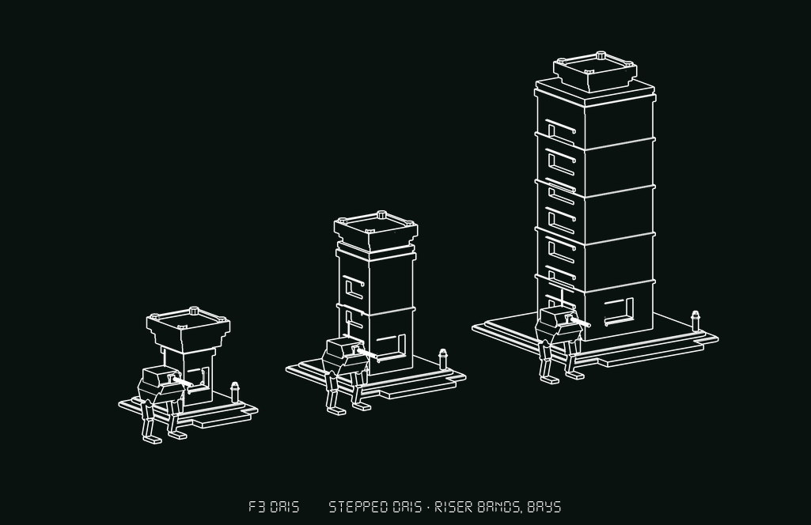
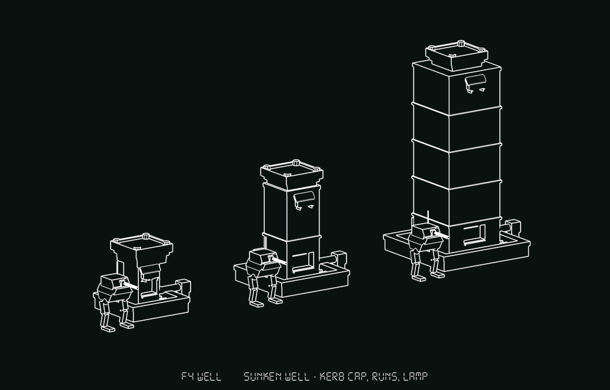
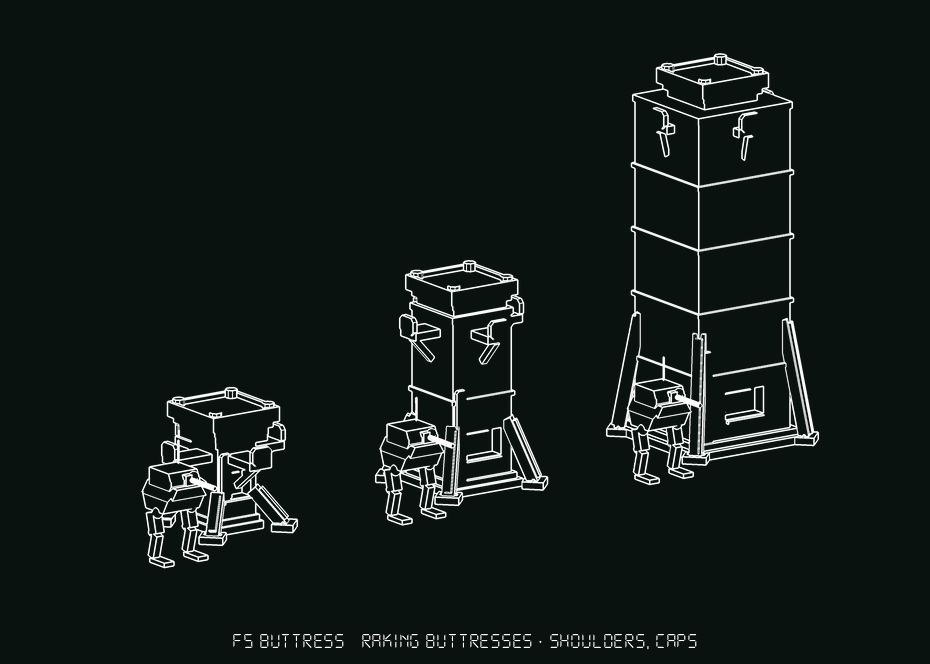
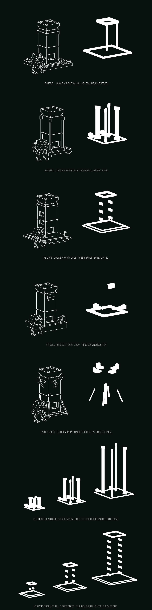

# COMPUTE CORE — F refined: five bases, five ways to paint it

Five variants of the selected concept, three sizes each · **status: variants
drawn, nothing selected**

Sheets: `core_f_variants.png` (all five plus the drone row), `core_f_f1.png` …
`core_f_f5.png` one row each, **`core_f_tick.png` — TICK seated on the medium of
all five, which is the occlusion test** — and **`core_f_paint.png`, which is the
sheet that actually answers the human's note: every variant's medium drawn
twice, whole and then the painted parts alone.** Builders:
`tools/concepts_core_f.gd`. Renderers: `tools/shoot_core_f.gd` and
`tools/shoot_core_f_paint.gd`.

**Read `core_f_paint.png` before anything else here.** The five structure sheets
show that the bases differ and nothing else: a painted fin and an unpainted one
draw identically in this line art, so the first version of this document had
measured colour shares and no picture of them. §7 is what the paint-only renders
turned out to say, and it changed the ranking.

Round two is `COMPUTE_CORES_2.md` / `compute_cores_2.png`. **F — CAPITAL won
it and its argument is not reopened here.** One 2.60 m lugged pad at every
size, the shaft growing beneath it in girth as well as height, because a cap is
a *terminator* rather than a neighbour: the eye compares cap width to shaft
width in the same part of the picture at the same depth. That is why a constant
cue at the top works where round one's B failed with a constant cue at the
bottom, and nothing below touches it.

---

## 0. What this round is answering

Two notes came back with the choice, verbatim:

> i like F the best but it needs to have clearly define and lots of places to
> have faction color, and it also needs to have a base

So F keeps its argument and gains two things, and every variant here is
recognisably F: **the pad, the corbel, the console, the band courses, the back
risers and the shaft widths (1.5 / 2.3 / 3.6) are identical in all five.** What
changes is the **foundation** and **where the colour lives**. Nothing else.

### The constraint nobody had written down

**In this project's line art a colour zone that is not also a SHAPE is
invisible.** `FactionLivery` works on the robots because the painted pieces are
separate meshes with their own edges. A flat face tinted a different colour
reads as nothing at all in the icon studio, and it reads as nothing at 60 m in
game either — same failure, different distance.

So nothing here is "a panel to paint". Every painted zone below is a **raised
plate, a recessed bay, a collar, a band, a fin or a shoulder** — a thing with an
edge, which happens to be the thing that takes the colour. The kerb wall in F4
is *not* painted; the capping course standing on top of it is. That distinction
is the whole round.

### Where the paint has to go, and the number that decides it

Each variant has to put colour in three places: **high**, so a core reads as
held from across the bowl; **at the approach face at eye level**, where the
player actually stands; and **below the cap**, because the Tick lands on the cap
and covers it.

That last one is a measurement, not a feeling. `ConceptsHack.tick_placed` is
built with the barb tips at y 0 and is seated at `target − 0.45`, so the barbs
reach down only to **y = target − 0.45** and the drone's body is above that.
**Anything at or below the corbel slab (y = target − 1.26) is clear of the drone
at every size.** Every collar, band, fin head and shoulder in these builders
sits at or under that line, and `core_f_tick.png` is the proof rather than the
claim.

### What it replaces

`Env/world_objects/core_signal.gd` fakes all of this today — a procedural deck
collar, a climb band, an `OmniLight3D` and a beacon column, tinted from
`HUDPalette` by owner (`FAC_ADVERSARY` / `GONE` / `HELD`). Its own header says
it is placeholder presentation and that "the real art can replace this without
touching the state machine". **These variants are that real art, and F4 is
almost literally it:** `_build()` puts its `DeckCollar` as a tube at the deck
because that is the read when you are standing on the objective, and F4's kerb
capping is that collar made of architecture.

### Method

Every number below is a **measured** bounding box printed by
`shoot_core_f._bounds`, subtraction shapes excluded. A row is **one photograph
with one camera**, so within a row the three sizes are at true common scale;
rows do not share a scale with each other and the 3.81 m Walker is the only
thing that carries across. **All fifteen land on 4.20 / 7.00 / 12.40 exactly** —
no variant argues for a different height.

**PAINT % is also measured**, by `shoot_core_f._paint_share`. The builders tag
every painted part `Paint_<tag>`; the renderer walks for the prefix, projects
each painted part's box onto the camera's own axes, and sums it against the
whole body's projected box. **It is a projected-box share, not a pixel count:**
painted zones here are spatially disjoint by construction, so the sum is close
to the union, but a part seen end-on still contributes its full box. Use it to
compare variants with each other, which is what it is for.

**And it has a bias, found by rendering the paint alone — see §7.** A tall thin
part's bounding box is mostly air, so the measure flatters vertical colour.
F2-large is quoted at 48.9%, and the paint-only render shows that colour is four
slender posts enclosing a great deal of nothing. **Where this document's numbers
and `core_f_paint.png` disagree, believe the picture**; the number is still the
right way to rank *how much* colour there is and the wrong way to judge *how it
reads*, which is exactly the distinction the first version of this document got
wrong.

**The paint-only sheet is a filter over the same build**, not a second set of
geometry — `shoot_core_f_paint._paint_filter` calls the same builder and deletes
every `VisualInstance3D` whose name does not start with `Paint`, so the two
cells cannot drift. The two cells stand on one ground plane and are shot with
one camera, so a height in one is the same height in the other.

**On the fill, which was rendered both ways and not guessed.**
`IconStudio.render_body`'s last argument fills an outline solid. The sheet uses
**outlines for the structure cell and solid for the paint cell**: the row is
rendered twice and composited at a seam computed from the camera (`_split_px`
reproduces `IconStudio._aim` — same yaw, pitch, distance, `PAD` and orthographic
fit) rather than found by looking at the picture.

The losing version is reproducible — pass `outline` as a second argument to
`shoot_core_f_paint.gd` — and it loses clearly. **Outlined, F2's four fins come
out as four hollow boxes drawn in exactly the line weight the structure cell
uses, and the eye cannot tell "this is the colour" from "this is more metal",
which is the identical failure the whole sheet exists to fix.** Solid, they are
unmistakably a separate substance. A colour zone is an *area*, and an outline of
an area is a wire frame of nothing. Both cells filled was not kept either: it
turns the structure cell into a silhouette and you lose what the colour is on.

**There are no chiller drums on these and round two's F had them.** They went in
for one render and came straight back out: with a drum stood off each flank,
F1-large measured **10.72 m wide against 8.08 for the base alone**, so a third of
the quoted footprint was dressing lifted from another round and the five bases
could not be compared at all. Every width below is the base's own width plus
whatever paint stands proud of it, which is the figure a level designer has to
leave room for.

---

## 1. F1 — APRON · cast apron, lip, collar, pilasters

Measured **4.09 × 4.20 × 4.09** · **5.61 × 7.00 × 5.61** · **8.08 × 12.40 ×
8.08**. Paint **50.0% / 41.3% / 33.1%**.

**What changed.** A single cast slab laid on the ground, well wider than the
shaft, with a raised lip all the way round it, cable ducts cast into its face
running out to both flanks, four cleats, and a low pedestal in the middle that
the shaft stands on.

**The base, and what it does beyond looking right.** It **draws the interact
footprint on the ground.** `InteractRaycast` is 2 m and does not fire when it
starts inside the volume, so reach is the core's own footprint and not a metre
more — which today is an invisible rule the player discovers by failing. An
apron with a lip is that rule made of concrete: stand inside the lip and it
works. It is also the flattest of the five and the only one that adds no step at
all, which matters because this is ground the squad walks over and **playable
ground has to be flat.**

**Where the colour goes** — the conservative distribution, three zones,
**33–50% of the projected picture**:

- **The lip**, a 0.26 m rim round the whole apron. Ground level, 360°, never
  occluded by anything including the drone, and it is the ring you are standing
  *inside* when you take the objective. Biggest single zone at every size.
- **The collar**, a 0.44 m band standing proud just under the corbel at
  y = neck − 0.66. High, reads at range, a full metre below the lowest barb.
- **Two pilasters** framing the console bay, from 0.9 m up to just under the
  collar. Eye level, at the exact spot the player stands.

**The honest weakness.** *It is the least distinctive of the five.* A capped
column on a slab is what a compute core already looks like, and F1 is the
variant you would struggle to describe to someone over the phone. The apron also
grows fastest with size — **8.08 m square on the large against the shipped
5.19** — because it is scaled off the shaft, and a flat 8 m square is the
largest piece of reserved ground in the set for the least shape. Second: the
collar is the only high zone, so if a dressing pass loses it the core reads
unheld from 100 m.

*Rejected inside this variant:* painting the apron's top face instead of its
lip. That is the flat-face fault in its purest form — a tinted horizontal
surface seen at a three-quarter angle is a sliver, and seen from above it is
behind the drone.

---

## 2. F2 — RAFT · bolted raft, four full-height fins

Measured **3.28 × 4.20 × 4.23** · **4.43 × 7.00 × 5.39** · **6.30 × 12.40 ×
7.26**. Paint **86.8% / 66.0% / 48.9%** — **the most colour in the set by a
distance, at every size.**

**What changed.** A steel raft plate carried on four short pads with a 0.3 m
shadow gap under it, its edges bolted with stud rows, a lip round it, and two
conduit trunks leaving it at the back. And then four blade fins.

**The base.** It is the only base here that is obviously **portable** — a thing
craned in and bolted down, not cast in place. That is the right fiction for a
machine StratCom plants to take ground, and it is the one base that survives
being put on a slope, because a raft on pads can shim and an apron cannot. The
shadow gap is the whole tell: 0.3 m of daylight under a 0.22 m plate is what
separates "bolted down" from "poured". It gives the player a 0.3 m step — low
enough not to be a pathing event, high enough to say *on* and *off*.

**Where the colour goes** — the maximalist answer, and it is one idea rather
than three:

- **Four blade fins at the shaft's corners**, each standing 0.25 m proud on the
  diagonal, running the whole height of the shaft from a flared foot on the raft
  to a flared head under the corbel. They are on the **diagonals** so no two
  faces are ever hidden at once: from any bearing on the ground at least two
  fins are in profile and one is in plan. They satisfy all three requirements by
  themselves — the heads are the high read at exactly the corbel height the
  drone cannot reach, the middles pass through 1.55 m on both sides of the
  console bay, and nothing in this variant is on the pad at all.
- **The raft lip** and **the two conduit runs**, both at ground level.

**It is the only variant whose colour does not collapse under the drone.** With
the Tick seated, F2 still measures **51.0%** painted — the next best is F3 at
40.9% and F4 falls to 22.0%.

**The honest weakness.** *At 86.8% on the small core it is not a grey machine
with faction colour on it, it is a faction-coloured object.* That is a different
kind of thing — closer to a flag than to plant — and the small core in
particular is more paint than metal. There is a dial here (fewer fins, or fins
that stop short of the console band) but somebody has to turn it with an eye,
and I cannot. Second, and found by looking at the sheet: **in three-quarter view
a diagonal blade reads as a square post**, so the large core photographs as a
four-post cage rather than as four painted fins, which is a weaker idea than the
one that was drawn. **§7 confirms that outright** — alone, F2's colour is a cage
at all three sizes — and names the fix: fins on the four faces rather than the
four corners, where their width lies in the elevation.

---

## 3. F3 — DAIS · stepped dais, riser bands, recessed bays

Measured **4.34 × 4.20 × 5.08** · **5.62 × 7.00 × 6.36** · **7.70 × 12.40 ×
8.44**. Paint **58.4% / 52.4% / 47.5%** — and crucially **the flattest curve in
the set**: it loses only 11 points from small to large where F1 loses 17 and F5
loses 17.

**What changed.** Two 0.22 m steps, square, with a third wider tread thrown out
at the approach face so the dais has a **front**, and two bollards at the top
step's front corners.

**The base.** It is the only base that moves the player's **feet**. On the other
four you walk up to the core; on this one you step up onto it, and a 0.44 m rise
is the cheapest way to say "you are on the objective now" without a trigger
volume or a line of UI. The wider front tread is what makes the console face
*the* way in rather than *a* way in. It also lifts the console's user clear of
ground clutter at the one face where a squad will be stood around him.

**Where the colour goes** — the distributed answer, small zones and many of
them:

- **Riser bands**, a proud band on each of the two step risers. Ankle and knee
  height, 360°, and the thing you look down at while standing on the objective.
- **Recessed bays**, a stacked column cut into each flank with a painted back
  plate set *into* each one and a lintel standing proud over it. Three edges per
  bay, so the colour is bounded whether or not the recess survives the
  photograph — **a bored hole draws identically to a flat face at `fill = 0`**
  and that is what nearly killed the Yoke. The bays are counted off the shaft's
  real run, so **the count grows with the core: 1 per flank on the small, 3 on
  the medium, 7 on the large.** The number of colour zones is itself a size cue,
  which nothing else in either round manages.
- **The lintel course**, a painted band immediately under the corbel. High, and
  below the drone.

**The honest weakness.** *The riser bands barely read.* They are the ground-level
zone and on the sheet they are two thin lines you have to look for — at 60 m
they are gone, and anything standing on the dais occludes them. So F3's real
colour is the bays, which are mid-height only: it has the best mid-band read in
the set and the worst ground read. Second: **two steps is two more things for a
nav bake to quantise**, and Godot has no per-agent path clearance — the bake is
the only clearance enforced, so a 0.22 m step is either free or a wall depending
on the agent, and that is a conversation the TERRAIN lane has to have before
this gets brushed.

---

## 4. F4 — WELL · sunken well, kerb cap, runs, lamp hood

Measured **5.28 × 4.20 × 5.09** · **6.09 × 7.00 × 5.89** · **7.38 × 12.40 ×
7.18**. Paint **39.7% / 28.3% / 19.5%** — the least in the set.

**What changed.** The shaft rises out of a kerbed well: a square kerb wall
standing 0.64 m above ground with a capping course on it, a grating bridging the
gap between the kerb and the shaft's footing, and two conduit runs climbing out
over the kerb and away across the ground on different bearings.

**It is a kerb and not a hole, deliberately.** A bored pit draws identically to a
flat face at `fill = 0`. What makes this read as a well is the thing standing
**proud** of the ground, not the thing missing from it; in a built level the
TERRAIN lane can sink the floor inside and the drawing does not depend on it.

**The base.** It is the only base that says the core is **the top of something.**
A compute core plugged into buried plant is a better object than one bolted to a
slab: it explains why it is *here* and not forty metres left, it gives a mission
designer a reason to put one where the ground is already dug, and the kerb is a
built-in piece of prone cover for the squad holding it.

**Where the colour goes:**

- **The kerb capping**, a painted course on top of the kerb wall, waist high,
  360°, surrounding the player. This is `core_signal`'s `DeckCollar` made of
  architecture, at the same height and for the same reason.
- **The conduit runs**, painted pipe sections leaving the well and running off
  across the ground to gland boxes. **The only colour in the set that leaves the
  footprint** — readable from a bearing where the core itself is behind cover.
- **The lamp hood**, a hooded signal box high on the approach face under the
  corbel, on its own brackets. The hood is what gives it a top edge; a box flush
  on a wall has none.

**The honest weakness.** *It has the least colour and it loses it fastest* —
19.5% on the large, and 22.0% with the drone on. Two of its three zones are at
ground level, so a 12.4 m core is eleven metres of unpainted shaft with a ring
round its foot, which is the opposite of what "readable across a map" asks for.
Second, and this one cost a render: **at 0.55 m with a 0.2 m cap the kerb
photographed as a planter box round a post**, and two runs reaching 1.4 m past
it finished the job by reading as a guardrail. It is at 0.64 with a 0.26 cap and
shorter runs now and it reads **in the whole-structure cell** — but §7 is the
harder test and it does not pass it: alone, the kerb cap is a flat picture frame
lying on the ground, the runs vanish into its own line, and the lamp hood floats
unconnected four metres above it. Third: a kerb ring with a gap inside it is the
worst shape in the set for a nav bake.

---

## 5. F5 — BUTTRESS · raking buttresses, cantilevered shoulders

Measured **4.36 × 4.20 × 4.36** · **4.44 × 7.00 × 4.44** · **5.36 × 12.40 ×
5.36**. Paint **36.1% / 30.2% / 19.4%**. **The smallest footprint in the set at
medium and large, and the only one under the shipped core's 5.19 m.**

**What changed.** F's own two-step plinth, kept, with four buttresses raking out
from the shaft's corners down to bolted ground pads, each with a capping strip
along its back.

**The base.** The buttresses widen the **footprint** without widening the
**shaft**, and that is the point. The shaft's width is the size cue — it is the
thing the constant cap is compared against — so any base that fattens the shaft
to look planted is spending the concept's only ruler on its foundation.
Buttresses buy the planted read on the **diagonals**, where the eye is not
measuring. They are on the corners and not the faces so the approach face stays
clear for the console and all four elevations keep a readable flat.

**Where the colour goes** — the answer aimed squarely at the occlusion problem:

- **Four shoulders**, cantilevered out to **2.1 m from the axis** at the corbel,
  each a horizontal bracket with a raised blade standing on its outer end.
  **Measured against the drone:** the Tick's barbs land 1.82 m from the axis and
  its placed box is 3.23 m across, so a shoulder reaching 2.1 m stands *outside*
  the drone in plan as well as below it. **This is the only painted zone in the
  set that is visible from directly above a hacked core.**
- **The buttress caps**, four raking strips running down to the ground pads.
  They put colour on the diagonals, which is the bearing every other variant is
  weakest on, and they are the lowest painted thing here.
- **The banner**, a tall painted plate standing proud beside the console bay —
  beside it and not over it, because a painted plate on top of the lit plate is
  two things fighting for one patch of wall.

**The honest weakness.** *The small core is a mess.* Four buttresses and four
2.1 m shoulders on a 4.2 m object leaves almost no plain surface anywhere —
measured 4.36 m wide against 4.20 tall, so it is as wide as it is high, and on
the sheet the shoulders and the buttresses merge into one spiky outline. A
constant 2.1 m shoulder is the same trap as a constant cap with none of the
payoff: the cap is a terminator and the shoulders are neighbours, which is round
one's B all over again. Second: **19.4% on the large is only a hair above F4**,
because shoulders are small objects at a great height. Third, the buttresses are
the most geometry of any base here and all of it is structure a brush pass has to
actually build.

*Rejected inside this variant:* buttresses on the four faces rather than the
corners. One of them lands on the approach face and stands between the player
and the console, which is disqualifying under the brief's own rule.

---

## 6. Where they disagree

| | the base is | base does | footprint, large | paint S / M / L | paint with the drone on |
|---|---|---|---|---|---|
| **F1** APRON | a cast apron with a lip | draws the interact footprint | 8.08 × 8.08 | 50.0 / 41.3 / **33.1** | 32.1% |
| **F2** RAFT | a bolted raft on pads | portable, shims on a slope | 6.30 × 7.26 | 86.8 / 66.0 / **48.9** | **51.0%** |
| **F3** DAIS | two steps with a front | moves the player's feet | 7.70 × 8.44 | 58.4 / 52.4 / **47.5** | 40.9% |
| **F4** WELL | a kerbed well | says it is the top of something | 7.38 × 7.18 | 39.7 / 28.3 / **19.5** | 22.0% |
| **F5** BUTTRESS | a plinth with four rakes | widens the foot, not the shaft | **5.36 × 5.36** | 36.1 / 30.2 / **19.4** | 23.2% |

Two findings fall out of the table and neither was obvious before the render:

**Colour share falls with size in all five, and the ones that fall least are the
ones whose zones run VERTICALLY.** A core is a tower; a zone that is a ring
round its foot is a fixed amount of paint on a growing object, and a zone that
is a fin up its side is not. F2 and F3 hold up because their colour climbs; F1,
F4 and F5 do not because theirs is a band at a height.

**The drone costs between 1 and 11 points of colour, and it costs the least
where the colour is lowest.** F2 *gains* share with the Tick on (48.9 → 51.0 at
medium scale) because the drone adds silhouette the fins are standing next to;
F1 loses nine. Nothing here is hurt badly by the hack, which is the thing
`core_f_tick.png` was rendered to find out.

## 7. What the paint-only renders showed — and it changed the ranking

Stripped of the grey structure, each variant's colour becomes a floating
constellation, and **three of the five turn out to be a different object from
the one the numbers describe.** This section is the finding; the per-variant
sections above are written as they were drawn.

**F2's fins read as a four-post cage, and that is now confirmed rather than
suspected.** `core_f_paint_f2.png` and `core_f_paint_f2_sizes.png` are
unambiguous: alone, F2's colour is four vertical posts standing on a square
frame, at every size, and on the large it is four bare sticks round an empty
rectangle — a bedstead, a boxing ring, a cattle crush. **It never reads as fins
on a tower.** The fault is the diagonal: a blade set at 45° on a corner presents
its narrow edge to every orthogonal bearing and its width only to the corner, so
in three-quarter view it is a post. *It is fixable and the fix is small* — move
the fins from the four corners to the four faces, where their width lies in the
elevation and they read as painted strips down the flanks instead of columns at
the edges. That is a half-hour change to `_fin`'s yaw and radius, not a new
concept, and it is the first thing to do if F2 is chosen.

**It also exposes a bias in this document's own metric.** F2-large is quoted at
48.9% painted, which is the highest number in the set at that size, and the
paint-only render shows four slender posts enclosing a great deal of air. A
projected *bounding box* is mostly empty for a tall thin part, so **the share
flatters vertical colour** — the direction §6's first finding points. The
finding stands (vertical colour does survive scale where a ring round the foot
does not), but F2's lead over F3 is smaller than 48.9 against 47.5 suggests,
and probably the other way round.

**F4's kerb reads as a picture frame lying on the ground.** Same question, same
answer: alone, F4's colour is a flat rectangular frame on the floor, two small
gland boxes, and the lamp hood floating by itself four metres above with nothing
connecting it. The conduit runs do not read at all — they merge into the frame's
own line. It is the least *connected* constellation in the set as well as the
smallest, and "a frame on the ground and a lozenge in the air" is a fair
description of what a player would see.

**F1 reads as a side table.** A square frame on the ground, one visible post
(the two pilasters overlap into one at this bearing), and a square plate on top.
Three zones, honestly placed at three heights — and together they make one piece
of furniture rather than three places.

**F3 is the one that survives the test, and it is not close.**
`core_f_paint_f3.png` alone shows a double ring on the ground, two vertical
columns of six separate bays climbing the shaft, and a plate at the top: **many
distinct, countable, separated places**, which is literally the words of the
note this round is answering. And `core_f_paint_f3_sizes.png` is the strongest
single image in either round — the bay count visibly grows **1 → 3 → 7 per
flank** while the ground ring grows with it, so the colour is not a fixed
decoration on a bigger object, it is a *quantity that scales with the core*.
Nothing else in two rounds of this concept says anything about size with its
colour.

One correction to §3 while looking at it: **the riser bands read better alone
than I gave them credit for** — as a double ring they are a legible landing/target
mark on the ground. They are still the first thing an object standing on the
dais will hide.

**F5 is a genuine constellation and a thin one.** Two chunky shoulder brackets
high up (only two of the four show from any one bearing), four thin buttress caps
low down that read as loose sticks lying against something, and the banner. It is
the second-most *distributed* paint in the set and close to the least paint by
area, and the buttress caps are the weakest-reading pieces here.

## 8. Ranking, and why

**Revised after the paint-only renders. The previous order had F2 first; §7 is
why it does not.**

**1. F3 — DAIS.** The note asked for colour that is **clearly defined** and in
**lots of places**, and F3 is the only variant whose paint, seen alone, is lots
of places: a ring on the ground, six to fourteen separate bays climbing both
flanks, a plate at the top. It holds 47.5% at the large size, second only to a
number that §7 shows is flattered. It is the only concept in either round whose
**colour count scales with the core**, so a 12.4 m core is not a 4.2 m one
wearing the same stripes. And the step is the cheapest "you are on the
objective" cue anything in this project has. The open costs are real but small:
the riser bands are hidden by anything standing on the dais, and two steps is a
nav-bake conversation the TERRAIN lane has not had.

**2. F2 — RAFT.** Still the most colour by a distance, still the only colour
that gains share with the drone on it, still the best fiction for the base — a
core is something StratCom *plants*, and this is the only base that looks craned
in. Second and not first because **its paint does not currently read as what it
is**: four corner blades photograph as a four-post cage at every size, and a
cage is one object rather than lots of places. Move the fins to the faces and
this is a strong first; until somebody does, the sheet says cage.

**3. F5 — BUTTRESS.** The sharpest single piece of reasoning in the round — the
shoulders are the only painted thing in either round visible from *directly
above a hacked core*, and the 2.1 m comes straight off the drone's own barb
reach — and the smallest footprint by a street, which is what decides whether a
core can go in a town. Third because the paint-only render shows a thin, loose
constellation: two shoulders visible from any bearing and four caps that read as
sticks lying against something. Promoted over F1 because at least its colour is
in several *places*, which is more than the apron manages.

**4. F1 — APRON.** The honest minimum and the thing to build if the answer is
"not now". It does the one job no other base does — it draws the interact reach
on the ground, which is currently an invisible rule the player learns by
failing — and it is the cheapest geometry here. Fourth because its paint alone
reads as a side table: a frame, a post and a plate, which is three zones that
make one object.

**5. F4 — WELL.** The best *story* — it is the only one that explains why the
core is where it is at all — and the weakest delivery, now visibly so. Least
colour at every size, two of three zones on the floor, a lamp hood that floats
unconnected four metres up, and conduit runs that do not read alone. **It moves
up sharply if the real question is what the player sees while standing on the
objective**, because its kerb cap is the only waist-high 360° ring here and it is
exactly what `core_signal` is faking today — but that is a different question
from the one that was asked.

**What I cannot judge, and the human can.** Two things.

- **Whether F2's cage reading is fatal or a half-hour fix.** I think it is the
  fix (fins on the faces, not the corners) and I have not drawn it, so F2 is
  ranked on what is on the sheet rather than on what I think it would become.
  If you want it drawn, say so and it is one more render.
- **Whether F3's recessed bays read as faction colour or as windows.** Lit
  rectangles stacked up a tower is also what a building's windows look like, and
  that is a look question about an object I cannot walk up to. If they read as
  windows, F3's first place goes with it.

## 9. Notes for whoever builds the selected one

- **The painted parts are named in the builders.** Every one of them is a node
  called `Paint_<tag>` — `apron_lip`, `collar`, `pilaster`, `fin`, `raft_lip`,
  `conduit`, `riser`, `bay`, `lintel`, `kerb_cap`, `run`, `lamp`, `shoulder`,
  `buttress_cap`, `banner`. That is the contract: those meshes take the owner
  colour from `HUDPalette`, everything else stays plant-grey. It is also how
  **both** renderers find the paint — `shoot_core_f` to measure the share and
  `shoot_core_f_paint` to draw it alone — so if the brush version renames them,
  neither the number nor the picture is reproducible.
- **Draw the paint alone before you believe any colour claim, including mine.**
  Three of the five variants read as a different object once the grey is taken
  away, and nothing in the structure sheets hinted at it. `shoot_core_f_paint.gd`
  takes an out dir and optionally `outline`; it is six lines of table to point at
  a different set of builders.
- **Measure, do not estimate.** `tools/shoot_core_f.gd` prints every builder's
  real bounding box and its painted share. Every number in this document came
  out of that run.
- **The renderer is a SIBLING of `shoot_cores2.gd`, not an edit of it** — same
  reason that one is a sibling of `shoot_cores.gd`. Round two's renderer
  hard-codes round two's builder file and re-pointing it would make round two's
  sheets unreproducible. One thing is new: `_paint_share`.
- **The three traps that did not have to be rediscovered**, carried in the
  builders' comments so they stay paid for: `CSGPolygon3D` extrudes along its
  own **negative Z** (every lug comes from `ConceptsCore2._lugs`, which carries
  the right sign); `_console()`'s height is **world**, not body-local (reused
  from `ConceptsCore2` rather than copied, for exactly that reason); a
  **handrail is the tallest thing on anything short**, so there is no rail in
  this file at all.
- **And one that was nearly rediscovered.** `_Parts.plate` extrudes along its
  own −Z, so a plate spans `[z − depth, z]`. The first pass put every painted
  plate's origin at `face_z − depth`, which floats it a hand's width off the
  wall — the kit's own "armour hovering off the hull" fault. Fixed in F1's
  pilasters, F3's bay backs, F4's lamp and F5's banner; the bay backs also needed
  `yaw = sx · 90°` rather than a fixed `+90°`, or the −X plate floats in the
  middle of its own recess.
- Nothing here touched `maps/`, any `.map`, `Env/world_objects/`, any objective
  script, or either earlier round's files. The builders are a drawing of an
  intention; the brush work is the TERRAIN lane's.
- The sheets in this directory are documentation images, not game resources —
  they have no `.import` files, which is correct until someone opens the editor.
