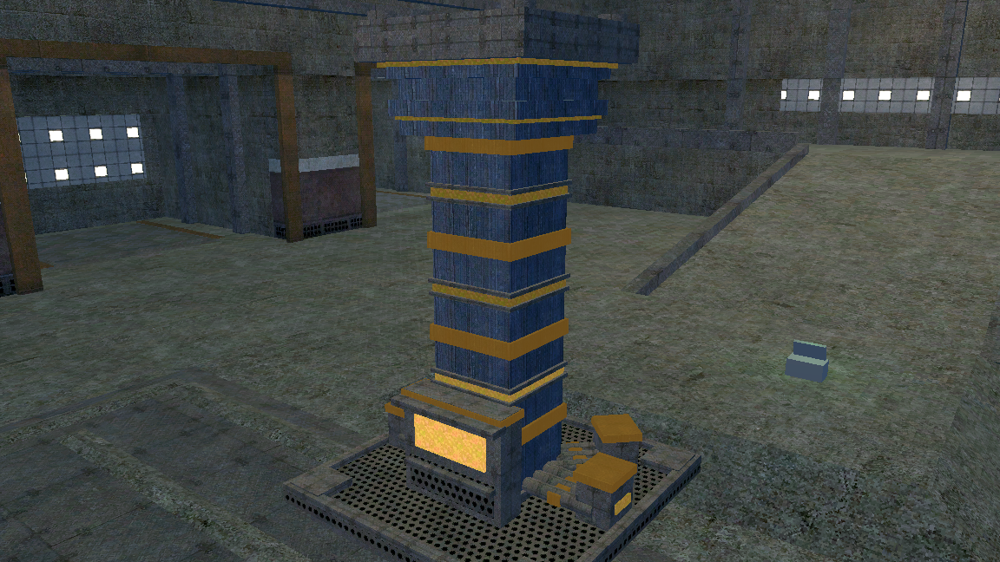
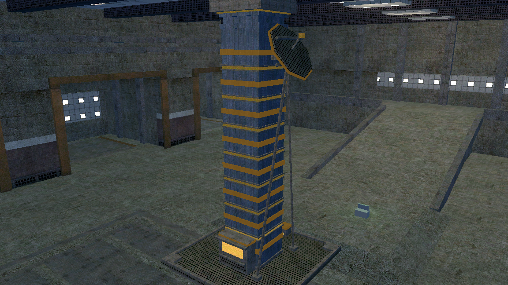
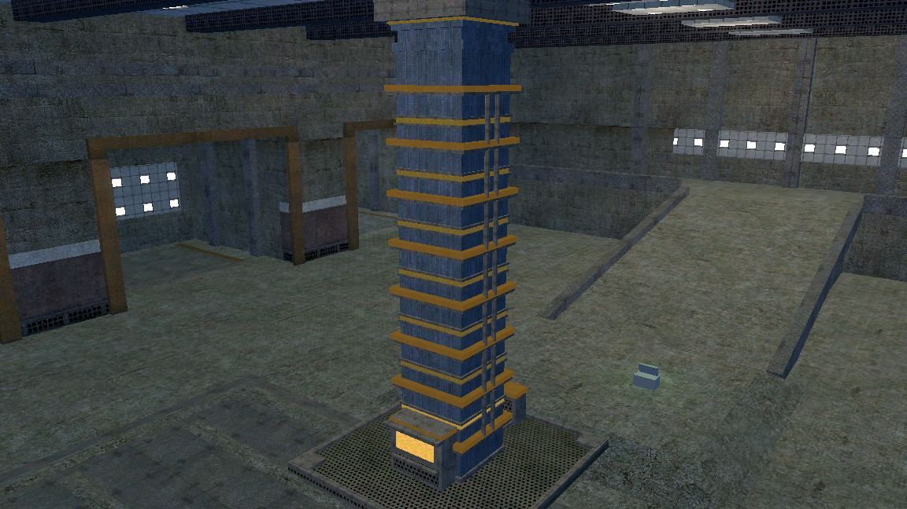
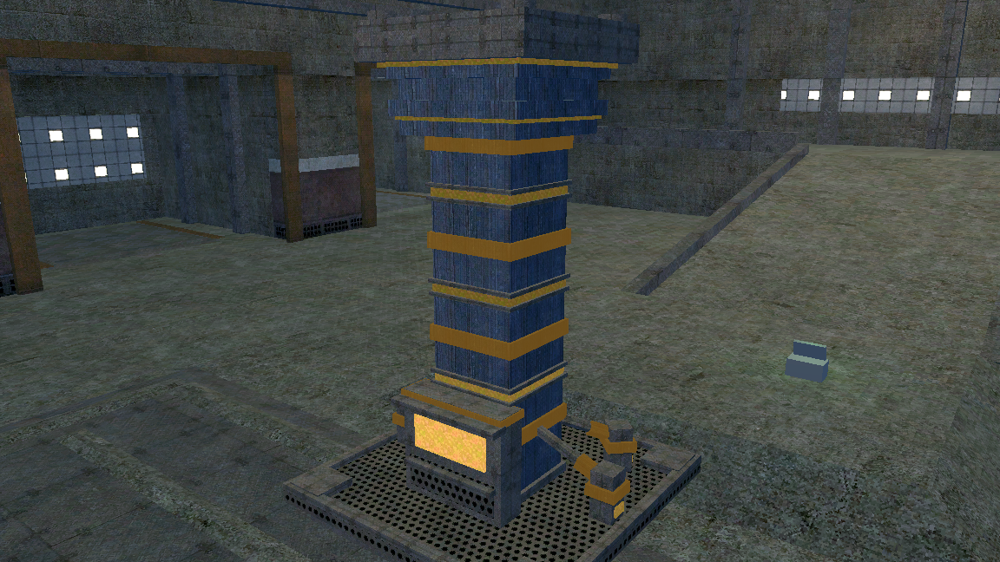
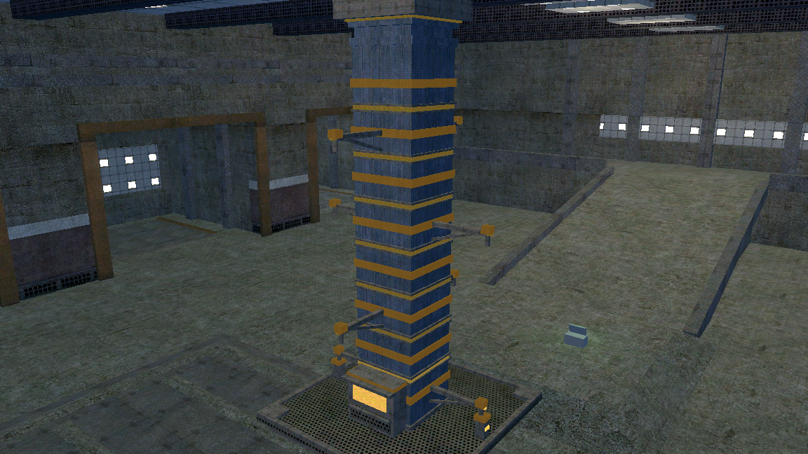

# COMPUTE CORE — LOOK 3: interlaced, thin, metal, connected

Five variants, three sizes each · **status: built and photographed lit, nothing
selected** · 2026-10-14

Builder: `tools/build_core_look3.gd` (new file; `build_core_f2.gd` untouched).
Scenes: `maps/blocks/compute/core_l3_<variant>_{small,med,large}.tscn`.
Renders: `core_l3_<variant>_<size>.png` in this directory, taken with
`tools/mockup_shots.gd -- <dir> props` — **lit, in a real level, which is the
only judge.** `core_l3_trunk_large_pulse.png` is the same rig with
`CORE_PHASE=0.45`, which freezes the travelling pulse so a still can prove a
moving thing. `core_l3_kit_vocabulary.png` is the existing kit this look was
designed against.

---

## 0. Why there is a third look, and what was actually wrong

Two builds were rejected. The approved concept was a slim shaft with a raft and
four blades; four rounds of notes later — *more places for faction colour, more
computery, glowing not flat, pulsing* — the shipped F2 photographs as a grid
tower covered in orange. **Each note was answered in isolation and the object
was lost.** Three separate faults, and this look exists because they are
separate:

1. **No quiet.** Four full-height amber fins, an amber ground ring and
   amber-lit rack strips means grey is the minority surface. A faction colour
   that is most of an object stops being a signal and becomes the object's
   colour.
2. **A full grid.** Four corner posts and four fins (verticals) crossing five
   shelf courses (horizontals), skinned in `metal_floor_3` — a perforated rack
   grille, which at 12 m tiles into a facade of windows. **A grid needs two
   directions**, and F2 supplied both.
3. **Therefore a building, not a device.**

The direction, verbatim:

> i think having interlaced color / non-color is good. i also think thin is
> better. it should look metal, not concrete. it's a connectivity feature that
> allows the player to take control of an area and its resources/compute so it
> should feel like that

### What every variant here shares

**One slim banded mast on a quiet deck, and the variant is what it is plugged
into.** The mast, the deck, the head, the cap and the console are identical in
all five; nothing else is.

- **Interlacing.** `_band_slots` divides the mast's own run by a **constant
  0.62 m pitch**, so the slot count is **4 / 8 / 17** at the three sizes and
  the painted rings are **2 / 4 / 8**. Odd slots are a painted ring, even slots
  are a lit reveal, and the mast starts and ends on bare metal — so the read up
  the tower is *metal, PAINT, metal, GLOW, metal, PAINT*. The band count is the
  size cue, so no variant needs a second one. **Measured: 17–18% of the mast
  run is faction colour at every size.** That number is printed by the
  generator, and it is the number F2 never took.
- **Thin.** Masts are **0.90 / 1.30 / 1.95** against F2's 1.50 / 2.30 / 3.60 —
  a little over half the girth. **Nothing vertical is drawn on the mast at
  all**: no posts, no fins, no pilasters, no bays. The only vertical line is
  `metal_wall_3`'s own ribs, which is a texture and therefore never becomes
  geometry at range. That is the whole of the anti-grid argument.
- **A console pedestal, not a bay.** F2 cut a 0.49 m recess into a 1.50 m
  shaft; the same recess in a 0.90 m mast leaves 0.41 m and cuts the stem in
  two. A separate terminal cabinet plugged into the mast keeps the mast
  unbroken and is *better for the brief* — a patch cabinet with a screen on it
  is a connectivity fitting; a hole in a wall is not. Screen at y 1.55, kick
  rail 1.02, brow at 1.92, all inside the 1.10–2.00 contract.
- **A quiet deck.** F2 painted a 0.16 m amber lip right round its raft, and in
  the lit shot that is a bright orange rectangle drawn on the floor which the
  eye finds before anything else. **The ground is unpainted here in every
  variant.** The only colour below a metre is a *collar on a fitting*, which is
  punctual rather than a ring.

### The metal, chosen rather than inherited

| where | texture | why |
|---|---|---|
| mast, flare, corbel, pad slot | **`metal_wall_3`** — dark navy ribbed | FAC_ADVERSARY is warm amber; navy is near-complementary, so the bands read at range. On `metal_wall_1` or `_4` (both brown) amber sits on amber and the whole mechanism dies. It is also far from FAC_ARGUS tyrian. Its fine ribs give extruded metal with no modelled verticals. **And it is the sheet the paint is on**, so a painted band and a bare band are the same material in two colours — which is what *interlaced colour / non-colour* literally asks for. |
| decks, plates, fittings, pipework, the landing deck | **`metal_floor_1`** — dark riveted plate | neutral, reads bolted and walkable, a value lighter than the mast so the gear separates from the stem. The landing deck is the one light surface on the object, so the cap reads as a *port*. |
| gratings, vents, the dish face | **`grate_perf`** | the "this thing breathes" read `metal_floor_3` was reached for, at a grain fine enough to stay a texture. |

**No concrete anywhere, and no `metal_floor_3` anywhere**, both deliberately.

### Carried forward because it was earned

`Paint` and `Lit` as two named groups under the root, every material
`resource_local_to_scene = true`, both lists setting `albedo_color` **and**
`emission`; `glitch_tx_1` on emission with `EMISSION_OP_ADD` so the faction
colour is a floor the data grain sits on; `core_pulse.gd` on the root,
unmodified. **The banding suits the pulse better than F2's rack strips did** —
a ladder of discrete reveals *is* a travelling band, where F2 had to cut
continuous strips artificially to give one something to step on. See
`core_l3_trunk_large_pulse.png`: 10 buckets, a 3.46 s cycle, two reveals
blazing and the rest at rest.

### One deliberate reversal, and it is a question for the human

**`PAINT_GLOW` is 0.45, not F2's 0.95.** At 0.95 the bands photographed as flat
plastic tape: emission at that energy with no emission texture is a constant
amber across the face, so `metal_wall_3`'s ribs — the reason this look is on a
ribbed sheet — were swamped and the bands stopped looking like metal. The two
earlier notes are now **split along the code's own Paint/Lit line**: *"bright/
glowing not flat"* is carried by the Lit reveals, which have a texture in their
emission and stay interesting at any energy, and *"it should look metal"* is
carried by the paint. **One constant moves it back** if that is the wrong call.

---

## 1. TRUNK — four cable bundles into the ground

Measured **3.28 × 4.20 × 3.28** · **4.43 × 7.00 × 4.43** · **6.30 × 12.40 ×
6.30**. Paint 11 / 13 / 17 pieces, lit 8 / 10 / 14, meshes 70 / 78 / 94.

**What it is.** The banded mast with four three-pipe cable trunks leaving its
foot on four bearings, running out across the deck and diving into the earth
through gland boxes with painted caps.

**How it says connectivity.** The most literal answer in the set and the
hardest to misread: a machine with four fat bundles disappearing into the
ground is *drawing something from somewhere else.* It is also the variant whose
pulse argument is cleanest — the gland ports are the lowest lit pieces on the
model, so the travelling band is **born in the cables and climbs the mast**.
The core is visibly pulling the area's compute up out of the ground it stands
on.

**Interlacing and scale.** The shared ladder, unmodified: 2 / 4 / 8 painted
rings, 1 / 3 / 7 lit reveals between them. The gear does not scale — four
trunks at every size — so the size cue is entirely the band count, which is
exactly what it was designed to carry.

**Honest weakness.** *The gear is low and the mast is tall, so at the shooting
bearing the console cabinet hides most of it.* Compare `core_l3_trunk_large.png`
with `core_l3_uplink_large.png`: at 12.4 m the trunks are a cluster of fittings
at the foot of an otherwise plain banded mast, and the variant's whole argument
is in the part you cannot see from across a map. It is the best variant up
close and the least distinctive in silhouette.

---

## 2. UPLINK — a dish on a braced boom

Measured identical to the set. Paint 5 / 7 / 11, lit 6 / 8 / 12, meshes 54 / 62
/ 78 — **the fewest pieces of the five.**

**What it is.** The banded mast with an octagonal dish cantilevered off a short
arm high up, two stays down to the deck, a lit feed horn on a boom at the
focus, and a small ground gland feeding it from the back.

**How it says connectivity.** The other four connect the core to the *ground*;
this one connects it to the **chain of command.** Taking a core hands an area's
compute to Argus, and this is the only variant that draws the route it leaves
by. The dish is sized off the deck half-width rather than typed, so its
outermost point stays inside the footprint square at every size.

**Interlacing and scale.** Shared ladder. The dish radius grows with the deck
(0.60 / 0.85 / 1.20), so this variant has **two** size cues rather than one —
band count and dish diameter — and they agree.

**Honest weakness.** *It is the least interlaced of the five and the least
symmetrical.* Only the dish rim carries paint off the mast, so paint piece
counts are the lowest in the set, and the dish hangs on one bearing — from the
opposite side the large core is a banded mast with a lump behind it. There is
also a fiction question I cannot settle: **a dish is an antenna, and the brief
says the core gives you an area's resources and compute.** If a core is meant
to read as drawing *from* the territory rather than reporting *out* of it,
this variant is answering a slightly different question very well.

---

## 3. PATCH — a stack of shelves with jumpers

Measured identical. Paint 4 / 6 / 10, lit 5 / 7 / 11, meshes 53 / 71 / **107**.

**What it is.** The interlace slots become **shelves** instead of rings: a thin
metal tray standing 0.17 proud with a painted front rail on it, and jumper
cables looping on both flanks from one shelf to the next. A junction cabinet at
the back fans five lines into the ground.

**How it says connectivity.** A patch panel is the object whose entire purpose
is joining lines together, and the jumpers are the only piece of geometry in
the set that implies the connections can be *remade*. It is the variant that
most looks like something you operate rather than something you own.

**Interlacing and scale.** Shelf, bare bay, lit reveal, bare bay, shelf — the
same ladder with a deeper section. The painted rail is 0.14 of a 0.62 pitch, so
this is the **quietest variant by colour share** and the busiest by piece
count; the jumper count grows with the shelf count, so the large core has 28
jumpers against the small core's 2.

**Honest weakness.** *It is the variant nearest the thing that was rejected,
and the large render shows it.* The jumpers are verticals. Put a dozen
verticals in front of eight horizontal shelves and you have re-made a grid —
not as badly as F2 (the verticals are round, in front of the mast rather than
in its plane, on two flanks only, at one stand-off) but the family resemblance
is there in `core_l3_patch_large.png` and I would not argue it away. Second:
107 meshes on the large is twice the UPLINK for a weaker read.

---

## 4. ANCHOR — four raking ties to ground bollards

Measured identical. Paint 11 / 13 / 17, lit 8 / 10 / 14, meshes 62 / 70 / 86.

**What it is.** The banded mast with four tie-rods raking out and down from its
**lowest** painted band to bollards at the deck edge, each bollard with a
painted collar, a lit port and a pipe into the earth.

**How it says connectivity.** It is the only variant whose *shape reaches out.*
The brief's line is that a core should look like it is **holding** a territory
rather than sitting in one, and four shallow ties going down and outwards is
the posture of something gripping. The kit's own `compute_obelisk` is built on
this grammar and nothing in three rounds has used it.

**Interlacing and scale.** Shared ladder, plus the ties are painted with a
sleeve at 72% of their length — so the colour is on the **diagonals** as well
as the horizontals, which is the bearing every other variant here is weakest
on. The gear does not scale; the bands do.

**Honest weakness.** *The footprint contract squeezes it.* The deck is only
1.1–1.8 m wider than the mast, so a tie from anywhere high is a 60-degree
member and reads as a **brace** — a prop holding something up — rather than a
tie. Taking them off the lowest band gets the rake to about 33 degrees, which
works, but it also means the entire variant lives below 1.6 m: on the large
core it is a thicket of small fittings at the foot of an eleven-metre banded
mast. It needs a wider deck to be what it wants to be, and a wider deck is a
nav rebake this look promised not to ask for.

---

## 5. RELAY — a pylon with cross-arms and downlines

Measured identical. Paint 7 / 11 / 19, lit 8 / 12 / 20, meshes 58 / 76 / 112.

**What it is.** Cross-arms at **every other** painted band, alternating bearing
level by level, each arm braced from below, tipped with an insulator and a
painted cap and a lit strip. Lines slung from the lowest arm's tips down to
gland posts on the deck.

**How it says connectivity.** A transmission pylon is the single most legible
*"this holds the grid for an area"* object there is. It is also **the only
variant whose connectivity is visible in silhouette from any bearing at any
range** — the other four need you close enough to read a fitting.

**Interlacing and scale.** This is the variant that scales hardest, and in two
registers at once: band count 2 / 4 / 8 as everywhere, and **arm levels 1 / 2 /
4.** The large core has four big arm levels with plain bands between them,
which is what makes the arm levels read *as* levels; an earlier build put arms
on all eight bands and it came out a Christmas tree. Arm reach is measured
against the deck (`rw * 0.55`, 1.35 / 1.87 / 2.70 m from the axis) so the
footprint cannot move.

**Honest weakness.** *The arms are thin and they are a lot of silhouette for a
nav bake to look at — even though none of it is in collision.* Also 112 meshes
on the large, the heaviest in the set, and the arms are the one feature here
that a TrenchBroom pass would find genuinely annoying to brush. Third, and this
is a judgement I cannot make: **a pylon is a very strong real-world referent**,
and it may drag the object away from "device" towards "infrastructure you have
seen" in a way the other four do not.

---

## 6. Where they disagree

| | the gear is | connectivity is | meshes S/M/L | paint pieces L | reads at range |
|---|---|---|---|---|---|
| **TRUNK** | four cable bundles into the ground | the core is wired in | 70 / 78 / 94 | 17 | weak — gear is all low |
| **UPLINK** | a dish on a braced boom | the core reports out | **54 / 62 / 78** | 11 | **strongest** |
| **PATCH** | shelves and jumpers | the core joins lines | 53 / 71 / 107 | 10 | medium, but grid-ish |
| **ANCHOR** | four ties to bollards | the core grips its ground | 62 / 70 / 86 | 17 | weak — gear is all low |
| **RELAY** | cross-arms and downlines | the core holds the grid | 58 / 76 / **112** | 19 | **strongest** |

Two findings that were not obvious before the lit renders:

**The deck is the problem all five share.** A 3.3–6.3 m square of quiet
grating is a lot of empty ground, and ground-level gear is invisible from the
bearing a core is actually seen from. The two variants that put something **up
the mast or out in the air** (UPLINK, RELAY) read; the two that put it on the
deck (TRUNK, ANCHOR) have their whole argument in the part you cannot see.
*This is the same finding CORE_F_VARIANTS.md §6 made about colour and it is the
same mechanism:* a core is a tower, so anything that is a fixed amount of
something at its foot gets smaller as the core grows.

**Triplanar UVs were a real fault, not a flourish.** A `BoxMesh` maps 0..1
across every face whatever its size, so a 256 px sheet stretched over a 2.6 m
cap and tiled into a 0.2 m band comes out looking like several different
materials at several different scales — the first lit shot had the grated deck
as four enormous polka dots and the cap as smeared planking, while the mast,
stretched the other way, looked correct. **Nothing about that is visible in
line art.** Every piece in this file is triplanar now at one tile per 2 m, and
the screens at one tile per 33 cm so a 0.06 m reveal still carries grain.

---

## 7. Ranking, and why

**1. UPLINK.** The clearest object in the set and the cheapest — 78 meshes on
the large against RELAY's 112 — and the only one with a silhouette you could
name from four hundred metres. It is also the only variant that gets a second
size cue for free (band count *and* dish diameter, agreeing). It wins on the
thing three rounds have failed at: **you can describe it over the phone.** The
reservation is a fiction question rather than a drawing one, and it is the
human's to settle: a dish says *reports out*, and the brief says *takes an
area's resources and compute*.

**2. RELAY.** The best answer to the brief as written. "A core should look like
it is holding a territory, not like it is sitting in one" is a pylon, and this
is the only variant that is legible as that from any bearing. It also scales in
two registers, which nothing in either earlier round managed. Second and not
first on cost and on referent: 112 meshes, arms that a brush pass will hate,
and a real-world silhouette so strong it may read as infrastructure the player
recognises rather than as StratCom equipment.

**3. TRUNK.** The most *honest* answer and the best up close: four fat bundles
going into the earth, a pulse that is visibly born in them and climbs, and the
calmest mast in the set. Third because its argument is at ankle height on a
twelve-metre object, which is the fault §6 is about. **It is the one to pick if
cores are mostly seen from inside their own footprint**, which is a question
about level layout I cannot answer and the TERRAIN lane can.

**4. ANCHOR.** The sharpest *idea* in the set — it is the only shape that
reaches — and the one the footprint contract will not let be itself. At 33
degrees the ties work and the whole variant is then below 1.6 m; any steeper
and they read as props. It moves up a long way if the deck is allowed to grow,
and that is a trade (one nav rebake) somebody could decide is worth it.

**5. PATCH.** The best *fiction* — a patch frame is literally where connections
are made — and the delivery nearest the thing that was rejected. Jumpers are
verticals, shelves are horizontals, and `core_l3_patch_large.png` has a grid in
it. It is also the second-heaviest in the set for the weakest silhouette.

### What I cannot judge, and the human can

- **`PAINT_GLOW` at 0.45 against F2's 0.95.** I have split "glowing" onto the
  Lit reveals and left the paint as painted metal, because the brief says
  *metal*. If the bands should still be self-lit tape, that is one constant.
- **Whether 17 slots on the 12.4 m core is "a bigger machine" or "a ladder".**
  The count is the size cue and it works at medium; at large it is eight bands
  and seven reveals over eleven metres and I cannot tell from a photograph
  whether that is impressive or busy. `BAND_PITCH` is one number.
- **Whether a dish is the right fiction.** See UPLINK.

---

## 8. Notes for whoever builds the selected one

- **Run the generator once, then the `.tscn` is the source of truth.** Same
  contract as `build_core_f2.gd`. It is not a build step.
- **The painted and lit pieces are the contract.** `Paint` and `Lit` under the
  root; an owner-colour pass walks both and sets `albedo_color` **and**
  `emission` on each material, or the surface repaints and keeps glowing in the
  previous owner's colour. Never write `emission_energy_multiplier` on a Lit
  material — `core_pulse.gd` animates exactly that float and reads the
  generator's value as the rest level.
- **Nothing is on the cap and nothing overhangs it.** The TICK clamps a 2.60 m
  pad at one size; every dish radius and arm reach in this file is computed
  against the deck for that reason.
- **Registration is not done.** These fifteen scenes sit beside the F2 set and
  the shipped cores; no wrapper, mission or `.map` has been repointed. Reach
  arithmetic: footprint minus 0.6 → `reach_size` **2.68 / 3.83 / 5.70**, the
  same as F2 because the footprints are the same. `indicator_height` 4.1 / 6.9
  / 12.3. A nav rebake is owed for any level that swaps one in — the deck is a
  0.52 m sheer step at 3.28 / 4.43 / 6.30 m square.
- **Look at the lit render before you believe any claim here, including mine.**
  Every fault fixed in this round — the UV stretching, the reveal hidden under
  its own lip, the floating feed horn, the stub cross-arms, the kinked ties,
  the orange slab on the console, the empty black deck — was found by looking
  at a photograph. None of them was visible in line art and none was reasoned
  to.
