# Concept — coming apart, and not coming apart

Mock-up, 2026-10-18. **Nothing here is implemented.** Every picture below was
posed by `tools/mock_damage.gd`, a throwaway generator that instantiates a
frame, shoves its nodes into the shape of a damage state, photographs it and
frees it. It does not touch `enemy.gd`, it never calls `die()`, `apply_damage()`
or `_collapse_pieces()`, and no frame scene was modified.

```
godot --audio-driver Dummy --path . --script res://tools/mock_damage.gd -- <out dir> [all|kinetic|ekill|eye|frames]
```

**It needs a window — run it without `--headless`.** The frames below are the
1152×648 the game renders at, through `Character/hud/signal_filter.gdshader`
with the uniforms `hud.tscn` actually authors, lit by `depot_level`'s own sun,
from a camera at **1.50 m** — the player's eye. The filter reads the screen, so
a headless render would come back flat and look like proof.

---

## The proposition in one picture

Kinetic damage **scatters**. An e-kill **preserves**. The silhouette alone is
supposed to tell the player which death it was, before any detail resolves.

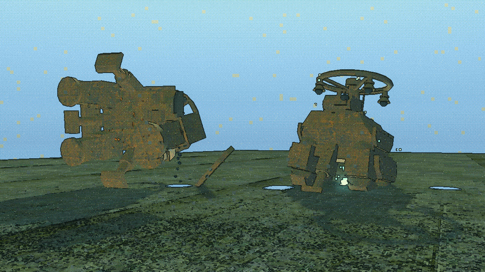

Left, shot to pieces: an outline nothing in the game makes while alive —
toppled, the mast folded, the canopy hoop at the wrong angle, parts on the deck
around it. Right, e-killed: a Bastion. Still a Bastion. Lower, folded onto its
legs, eye out, with the last of its charge going into the ground it is standing
on. Same frame, same light, same distance.

**This reads.** It is the strongest result in the set and it is the thing worth
building.

---

## A · Kinetic — five escalating states

On the **Bastion**, because the five states need a frame that has a bolt-on
plate which is its own render root, a limb it can lose and still be standing,
and one offset eye. Three of the ten frames fail one of those.

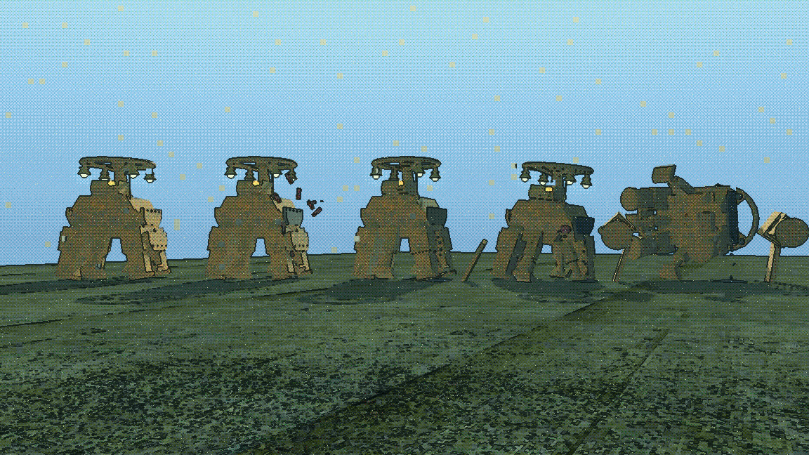

Left to right: intact, scuffed, breached, crippled, dead.

| state | what is actually done to the scene | reads at 20 m? |
|---|---|---|
| intact | nothing | — |
| scuffed | `SparkBurst` at the hit; `base_tint` and `shutdown` pushed on the struck applique | **sparks yes, scorch no** |
| breached | left skirt panel reparented to the world and laid on the deck; oil leak + pool | **yes** |
| crippled | `Rig/HipL` subtree detached, frame leaning onto the lost corner, socket filled | **yes** |
| dead | eye out, lenses out, livery shut down, `Rig` tipped 84° (`enemy.gd`'s own `collapse_pitch_degrees`) | **yes, instantly** |

### What did not read

**Scuffed and intact are the same robot at squad distance.** The sparks carry
the hit and the darkened plate carries nothing — at 20 m through a filter that
quantises luma to ten steps, a scorch mark is one shade of the same olive. It
reads fine in close-up and not at all in the row. If scuffing is meant to be
information, it needs to be geometry or a spark, not a tint.

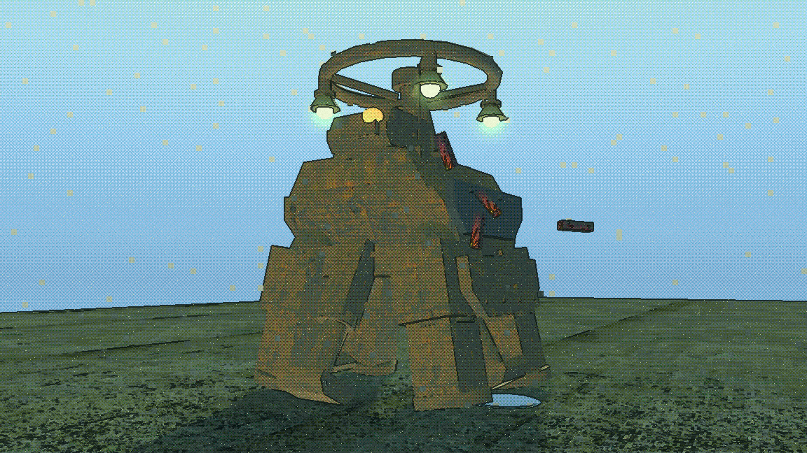
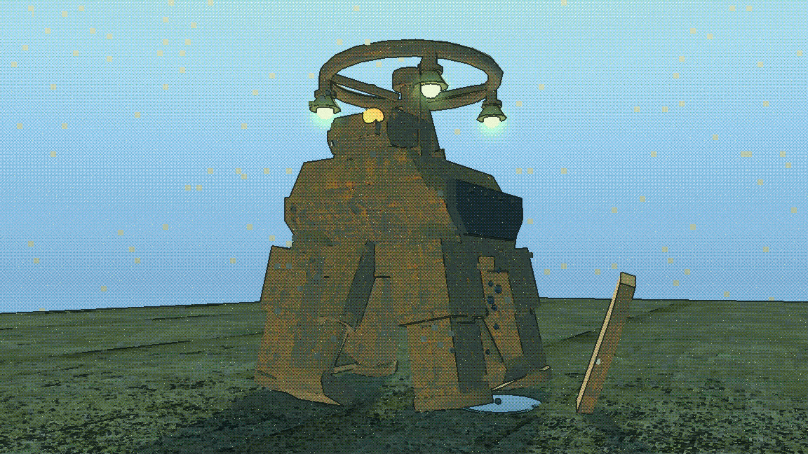
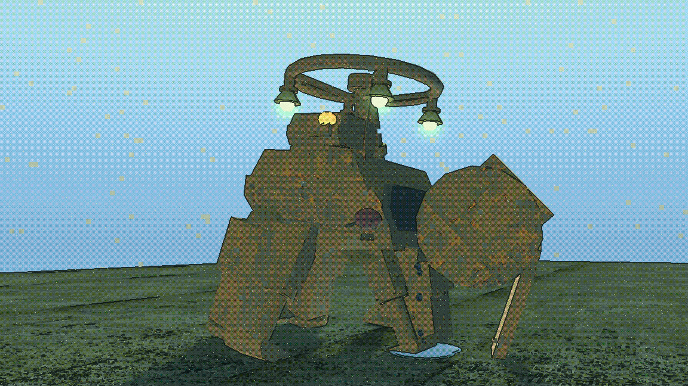

Breached and crippled both read because something **left the silhouette**. That
is the whole finding of section A: on these models, damage is legible exactly
when a part is somewhere it should not be.

---

## The cut face

The claim being tested was that a detached limb leaves a flat cut face which
wants filling with a dark emissive so it reads as torn open rather than
mesh-deleted.

**There is no cut face.** These frames are not solid CSG that gets carved — the
thighs, shins and feet are `MeshInstance3D` with primitive meshes, which are
closed, and the Hull is a closed CSG solid. Taking a leg off leaves two intact
surfaces and a gap between them.

| | |
|---|---|
| 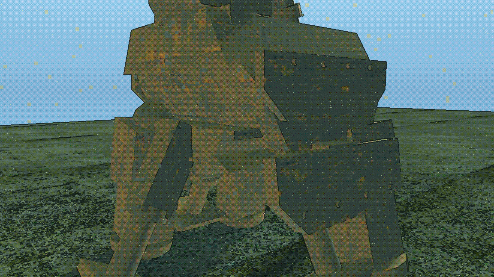 | 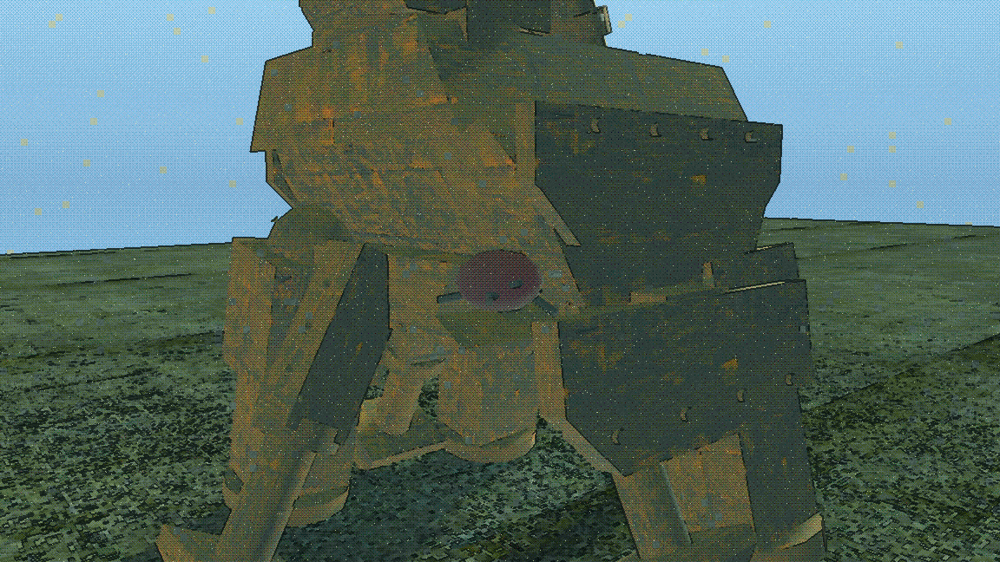 |
| **bare** — not a hole. It reads as a Bastion that was *built* with three legs. | **filled** — a dark socket with torn rods in it. It reads as a leg that came off. |

So the fill is still worth having, but for the opposite reason to the one
proposed: not to cover an artefact, but because without it nothing marks the
place where the limb was.

**And it has to be geometry, not a gradient.** The first fill was a smooth dark
emissive dome and it photographed as a flat maroon ellipse painted on the hip —
a decal. The signal filter flattens a curved surface of one colour onto one
luma step, so the shading that was meant to read as a cavity is quantised away.
Four bent rods sticking out of it put an outline back, and an outline is the
one thing the filter's edge pass can still see. **Anything built to read
through this filter has to carry its silhouette in its edges.**

---

## B · The e-kill

Four beats. The rule is that **nothing may leave the silhouette** — the only
thing that does is the earth discharge, once, at the end.

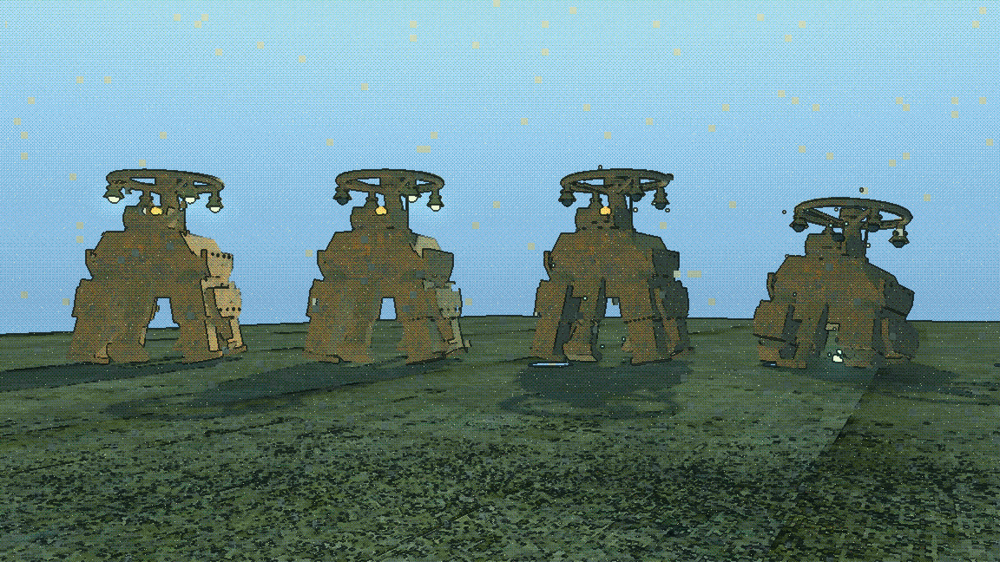

1. **lit** — the control. Canopy lenses on, eye on.
2. **lamps** — the lights go out top-down. The Bastion's four canopy lenses are
   the highest and they are already emissive in the scene (`emission` 0.42,0.90,0.52
   at 2.6), and like the eye they are off the `FactionLivery` piece list, so they
   are addressable without a repaint reaching them.
3. **arc** — every lamp out, **the eye still on**, livery `marker_energy` pushed
   to 5.6 on some pieces and 0.0 on others so the accents flicker.
4. **slumped** — four knees folded by different amounts in order, the splay
   rolled out, the rig sunk 0.72 m, eye out, earth discharge.

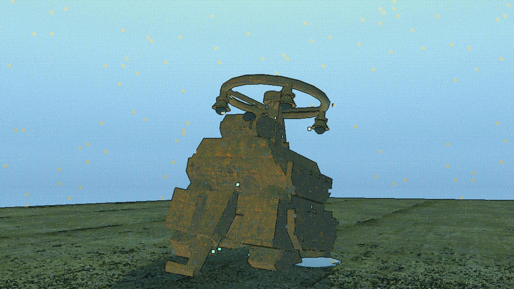

The eye going **last** is what makes the sequence read as something shutting
down in order rather than as a power cut. Holding it through beats 2 and 3 is
the whole trick and it costs nothing.

### What did not read

**The arc does not look like electricity.** `SignalArc` — the game's existing
suppression effect, reused deliberately rather than inventing a second visual
language — is 0.075 m additive quads. Through the signal filter at 8 m they
photograph as **pale cyan squares scattered across the sky**, indistinguishable
from the filter's own `block_glitch` artefacts. Look at beat 3 and 4 above: the
squares are the arc. Nobody will read that as a robot short-circuiting.

If the e-kill is to have an electrical tell, the arc needs to be bigger, fewer,
and attached to the chassis — or it needs to be something other than particles.

**`set_shutdown()` is a dimmer, not a death tell.** The shader line is

```
EMISSION = faction_color * marker_mask * marker_energy * (1.0 - shutdown)
```

so it takes the **glow** off the accent markers and leaves the **paint** under
them exactly as it was. On a Broodcarrier that is six amber beads that are
still six amber beads. It is useful as one layer of a death and it is not
sufficient on its own.

---

## The eye

**Tested first, and it works.** Every player-lineage frame has exactly one
offset `Eye`, and its material is deliberately held off the `FactionLivery`
piece list so a repaint cannot touch it. One node name, one material, every
chassis.

| | lit | out |
|---|---|---|
| **Bastion** | 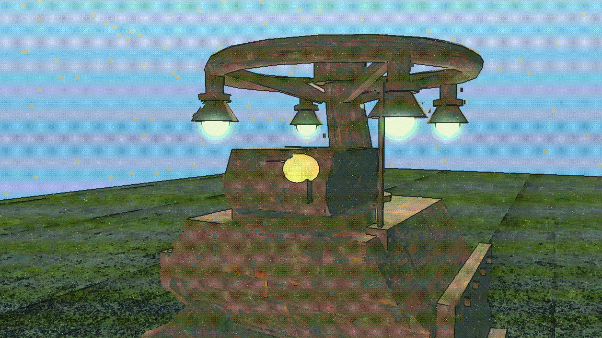 | 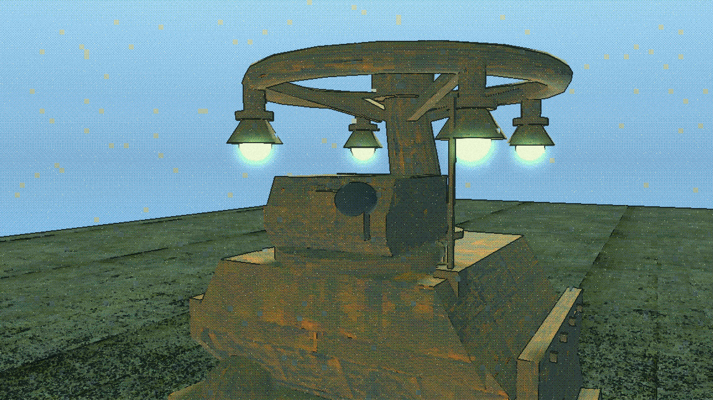 |
| **Tick** | 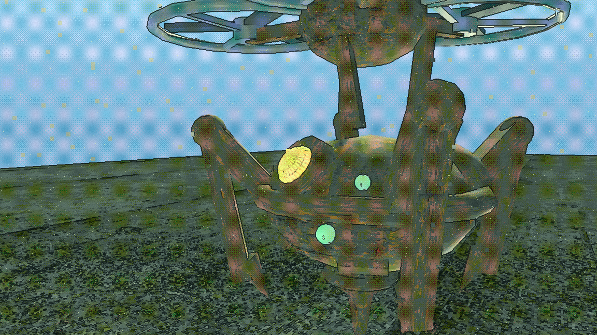 | 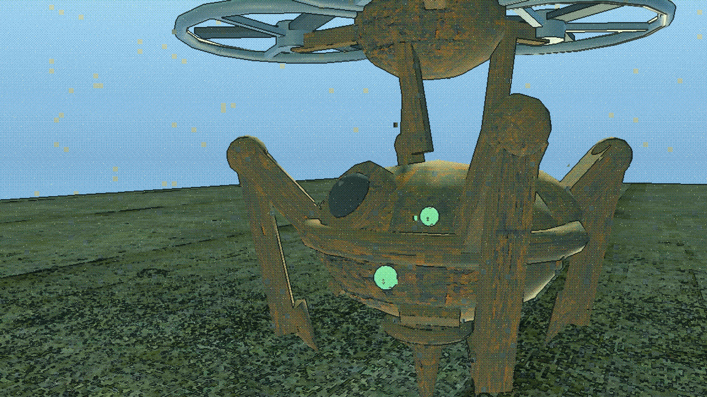 |
| **Vessel** |  | 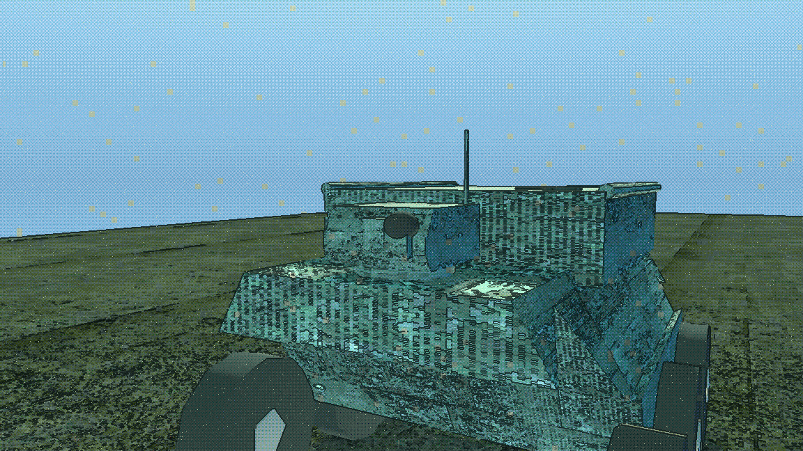 |

Three frames, three completely different bodies, one unmistakable read. On the
Bastion it is a warm bead under a mast of cold green lamps; on the Vessel it is
the only warm thing on a cyan hull; on the Tick it sits beside the frame's own
green lobe lights and still wins on colour.

### Three corrections to the proposal

**1. The eye is not emissive, so `emission_energy` writes nothing.** Checked on
every frame: the Eye's material is a `StandardMaterial3D` carrying
`albedo_texture = robot_eye_psx.png` and **nothing else** — no
`emission_enabled`, no `emission`, no energy. A live eye in the game today is
not glowing, and turning its energy down turns down nothing. The mock-up
switches emission on to take the "lit" photographs. Making the tell real is a
three-line change in the frame generators, and it is the first thing to do.

**2. It has to go dark, not dim.** Killing the energy alone leaves a pale bead
that still reads as a working lamp under the sun. The albedo has to go to
near-black as well. Both halves are in `_eye()`.

**3. It must not be keyed on the literal name `Eye`.**

- **See-Engine** has no node called `Eye`. Its lens is `Rig/GimbalYaw/LensPitch/Pupil`.
- **Broodcarrier** has **no eye and no pupil at all**, so it has no eye tell
  available on any terms.

A tell keyed on the string misses one frame and cannot serve another. It wants
a group, a meta, or an `@export var eye: Node3D` on `enemy.gd`.

### One more: emission has a ceiling in this game

The first pass lit the eye at `emission_energy_multiplier = 3.2` and
photographed a **white disc with an orange ring round it**. The filter
quantises luma to ten levels, so anything much over 2.0 lands on the top step
and the colour — which is the entire tell — is gone. 1.5 reads as amber. **Any
emissive authored for this game has to sit under the clip, not over it.**

---

## C · Per-frame identity

Alive on the left, dead on the right, one frame each.

### See-Engine — the lens goes dark and the gimbal goes slack

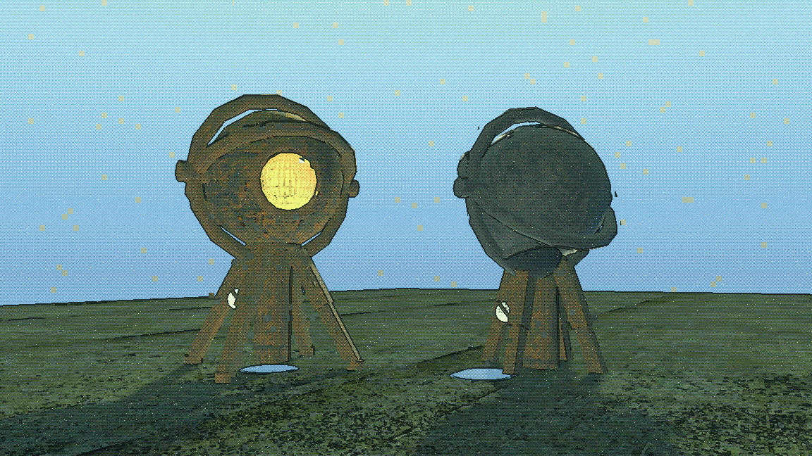

**The best result in the set after the silhouette test.** Nothing detaches:
this frame's whole character is that it is one enormous sensor, and breaking it
into pieces would make it a generic walker with bits off. The pitch hoop goes
over 72° so the 2.3 m lens hangs staring at its own feet, the yaw hoop lets go
17° off true — a gimbal that has lost its drives does not stop square — and the
legs give 11° so it settles rather than standing to attention with its head
down.

The alive/dead read is total and it is carried almost entirely by the lens
going from a warm disc to a dead black one.

### Tick — stop one rotor and it yaws, then drops

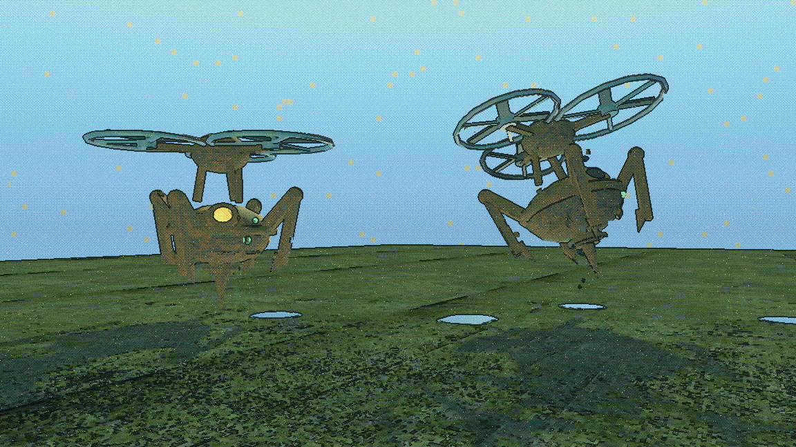

Three rotors on three booms, each its own subtree. `Rotor2`'s blades are
splayed 23° off true and its duct scorched, the boom droops 15° on the dead
side, and the rig is yawed 42° and canted 21° — caught on the way down rather
than landed. The yaw is the tell; nothing else in the game rotates about its
own axis while falling.

Caveat: photographed mid-fall it can read as *hovering* rather than falling. In
motion that resolves itself; in a still it is ambiguous.

### Brood — it breaks and the swarm spills out

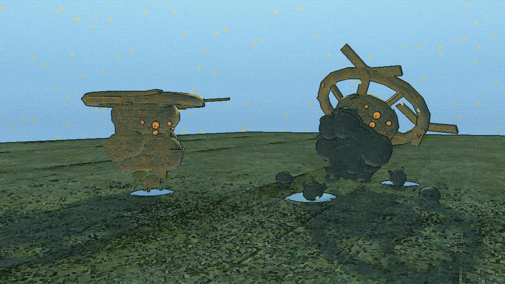

Three of six pods burst — flaps thrown 96–124°, stalks snapped, shells
scorched — the carrier over on its side, and hatchlings on the deck around it.
What the player sees is not a wreck, it is a problem that has just got bigger.

**A real content gap found doing this.** Only `Pod1` has a modelled `Hatchling`
inside it. Pods 2–6 are `Shell`, `Band` and `Stalk` — empty boxes. The spilled
ones in this picture are duplicates of Pod1's, which is honest for a mock-up and
would not be honest in the game.

### Vessel — panels spall and the hoppers show, before it dies

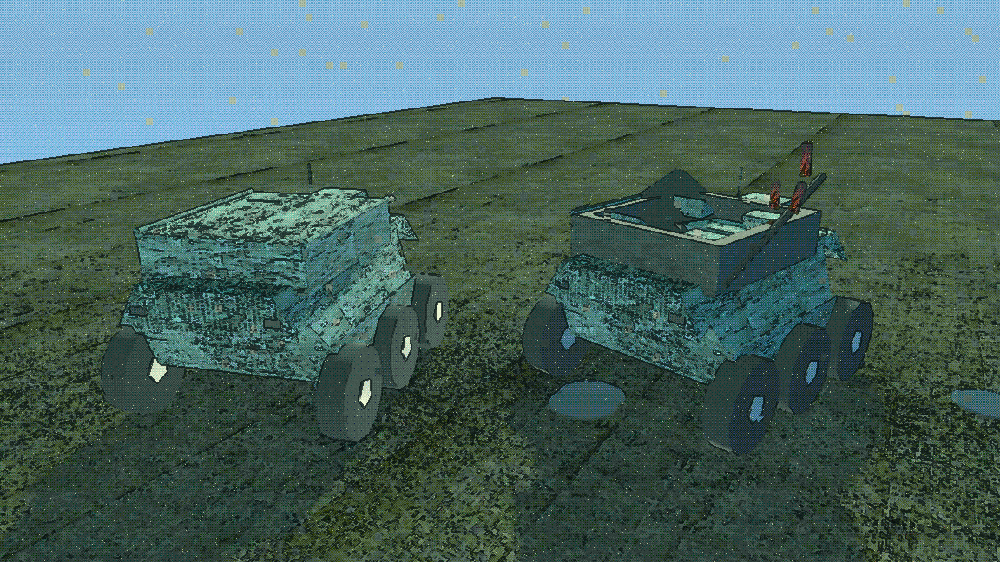

The one state here that is deliberately **not** a death. One bay door leaf torn
off and lying on the deck, the other hanging on a wrecked hinge, hinge bar bent
and scorched, coaming burnt — **and the eye still lit**, because the Vessel is
still driving. What the hole exposes is the cargo: two Hatchlings on their
cradles in an open well. A Vessel with its back open is still a threat, and now
everyone can see what it is carrying.

**And here is the problem with it.** `VESSEL_PANELS.md` says the player looks at
these surfaces "from above". **The player has no such view.** The bay is a well
in the roof of a 3.37 m vehicle and the player's eye is at 1.50 m. Shot from
there, a wrecked Vessel and an intact Vessel are the same photograph —
everything that happened to it happened on a surface pointing at the sky. This
picture is taken from **4.6 m**, which is a gantry or the Kite's view, not the
player's.

If the Vessel's damage is meant to be legible, it has to break the **sides**.

---

## What the model structure actually is

Stated plainly, because three of the assumptions this started from were wrong.

**They are not CSG trees.** Only the Hull, the turret body and the bolt-on
plates are `CSGMesh3D` roots. Thighs, shins, feet, lenses, dishes, studs,
rotors and blades are plain `MeshInstance3D` with primitive meshes. Two
consequences: a primitive mesh is closed, so there is no cut face (above); and a
`CSGBox3D` sitting **under** a `CSGMesh3D` is an operand of that root, not a
piece of its own — detaching one changes the parent's shape instead of taking a
panel off. **Anything that is to come off has to already be its own render
root.** On the Bastion that means `AppliqueL/R`, `Skirts/SkirtL/R` and the four
`Hip*` subtrees, and not much else.

**The parts are genuinely already separate**, which is the good news and it is
the whole reason this was cheap. Detaching a limb is
`remove_child` → `add_child` → restore the world transform. No vertex weights,
no bone splitting, about fifteen lines.

**`_pose_leg` is a live hazard, per leg.** `walker.gd`'s `_pose_leg` **assigns**
`hip.rotation.x`, `hip.rotation.z`, `knee.rotation.x` and both foot rotations
every physics frame, including zeroes at a dead stop. A limb reparented to the
world while `hip_left` still names it is driven from a body it has left — it
will sit on the deck twitching in step with the walk cycle of the robot it fell
off. `_unwire()` nulls every export that names the part before the reparent, and
prints which ones it cut:

```
unwired ["hip_left", "knee_left", "foot_left"] from Rig/HipL before detaching it
```

Worth knowing: on the Bastion **only `HipL` and `HipR` are wired to the pose
exports.** `HipLA` and `HipRA` — the rear pair — are named by nothing, are never
posed, and could be detached with no unwiring at all. The fragility is per leg,
not per frame.

**Materials are shared and every write must duplicate first.** `FactionLivery`
hands the same `ShaderMaterial` to every robot of a faction in the level on
purpose, and a `.tscn`'s sub-resource materials are shared between instances of
that scene. One unguarded write scorched all five Bastions in the progression
sheet, including the control. Everything goes through `_own()`.

**`FactionLivery.pieces` recurses, and it holds live node objects.** A detached
part has to be handed to `remove_pieces()` or the next repaint — or
`set_shutdown()` on death — touches a freed node.

---

## What to build first, if this becomes real

In order, cheapest and highest-value first.

1. **Light the eye, and give it a handle that is not its name.** An
   `@export var eye: Node3D` on `enemy.gd` wired in each frame scene, emission
   authored on the eye material at an energy under 2.0, and two lines in `die()`
   and `_enter_ekill()`. This is a universal death tell for every chassis in the
   game for about an hour's work, and it is the single thing in this document
   with the best ratio. Decide what the See-Engine's `Pupil` and the
   Broodcarrier's nothing do about it at the same time.

2. **The e-kill slump, as a pose rather than a ragdoll.** Four knee rotations,
   a splay roll and a rig sink, tweened over about a second in `_enter_ekill()`.
   It needs no new geometry, it cannot be confused with a kinetic death, and it
   is what makes "e-kill preserves" true rather than aspirational. Note the
   existing coroutine rule here — a tween chain, not `await process_frame`.

3. **Detachable parts, declared per frame.** An
   `@export var shed_parts: Array[Node3D]` listing the nodes that may come off —
   the Bastion's two appliques, two skirts and four hips — plus one shared
   helper that unwires, tells the livery, reparents, and fits a `RigidBody3D`
   with a capsule. A frame that declares nothing sheds nothing and still works,
   which is what makes this safe to roll out one frame at a time.

4. **The torn socket, as authored geometry.** One small mesh per shed point,
   placed as a child of the part's old parent and hidden until the part goes.
   Needs to carry an outline, per the cut-face finding.

**Do not build first:** the arc, or anything else that depends on small
particles reading through the signal filter. That needs a look-development pass
of its own before any system is attached to it.

### Open questions for the human

- Is **scuffed** worth a state at all, given it is invisible at squad distance?
  It may belong as a sound and a HUD event rather than a surface.
- The Vessel's damage is on its roof. Does it break its **sides** instead, or is
  it accepted that its damage is for the Kite to see and not the player?
- Game feel and timing are **not** judged here. These are stills. How long an
  e-kill should take to fold, whether a crippled frame should keep fighting, and
  whether any of this is satisfying are all open — I ran it, I did not play it.
