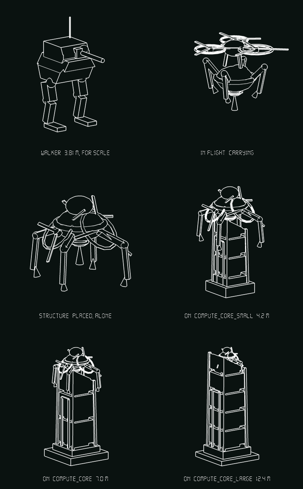
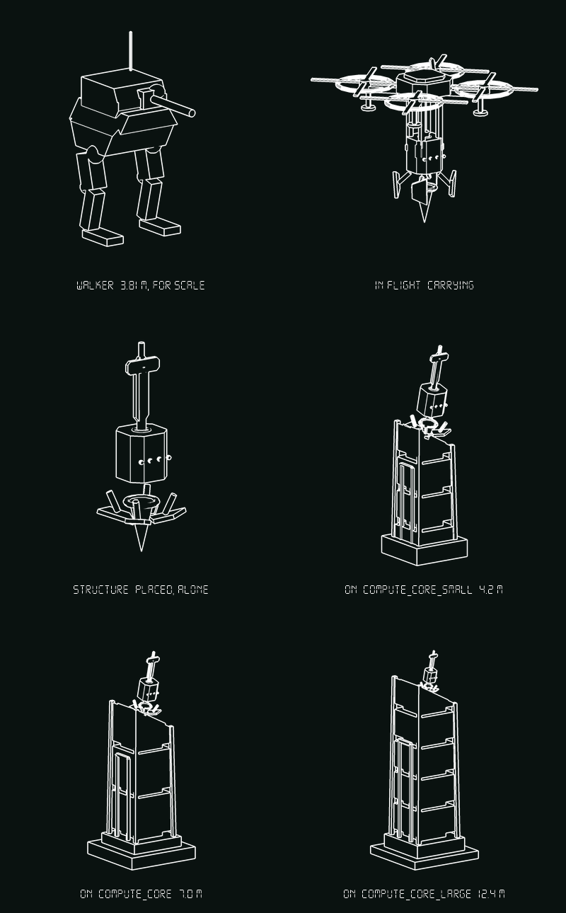
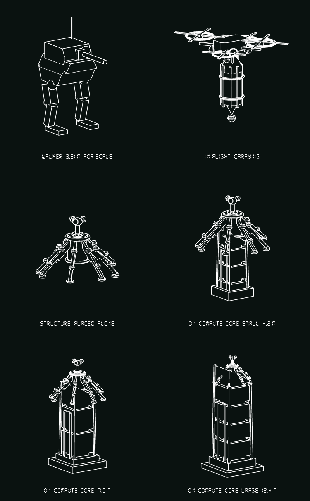
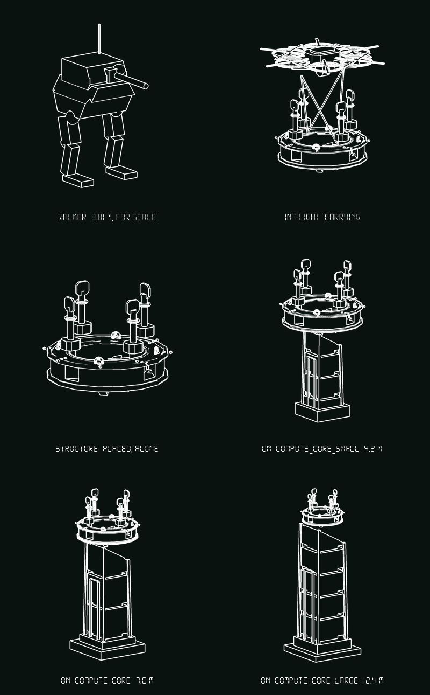
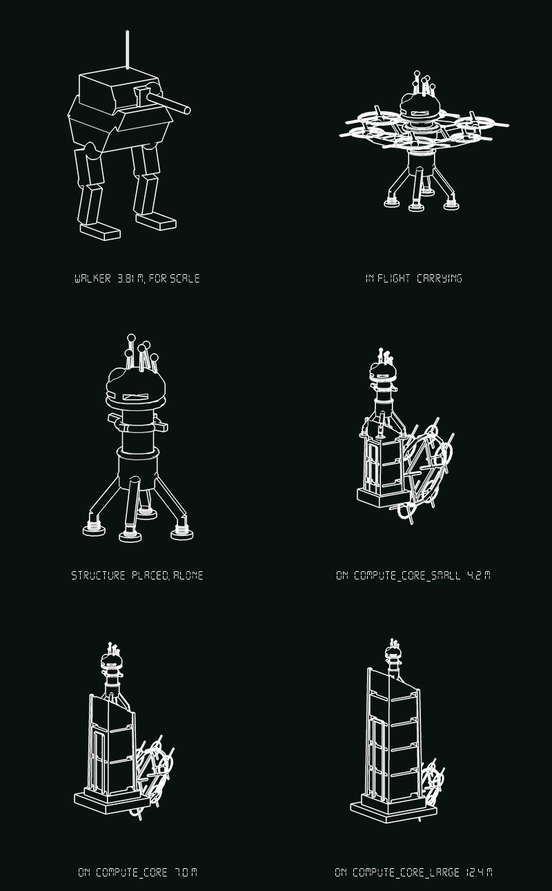

# HACK DRONE — concept exploration

Five answers to one problem, **status: nothing selected, nothing built**.

A flying machine lifts a large piece of hardware, flies to a compute core, and
puts it **on top**. The structure stays and does something to the core; the
drone is only the delivery. Both halves need designing, and the hard part is
that **they have to look like one object in flight and two objects afterwards.**

Builders: `tools/concepts_hack.gd`. Renderer: `tools/shoot_hack.gd`
(`godot --audio-driver Dummy --path . --script res://tools/shoot_hack.gd -- <out dir>`,
without `--headless`). Sheets: `docs/concepts/hack_{tick,piton,parasol,yoke,chrysalis}.png`,
six cells each — the Walker for scale, the thing in flight, the structure alone,
and the structure seated on all three cores.

Every figure below is a measured bounding box printed by `shoot_hack._measure`,
not an estimate. Walker, for scale, is 3.81 m tall.

---

## 0. What the core actually is, because four of the five designs come out of it

Read off `maps/blocks/compute/compute_core*.map` at FuncGodot's 32 units per
metre. The seated renders instance the **real scene**, not a stand-in: it is one
baked `ArrayMesh`, it costs one `load`, the icon studio already photographs it,
and a rebuilt copy would be a second set of numbers to keep honest.

| | `compute_core_small` | `compute_core` | `compute_core_large` |
|---|---|---|---|
| overall | 1.88 × **4.19** × 1.88 | 3.38 × **6.97** × 3.38 | 5.19 × **12.37** × 5.19 |
| top column, across | **1.25** | **1.875** | **3.00** |
| cap low (back) lip, y | 2.97 | 5.56 | 10.22 |
| cap apex (front), y | 3.81 | 6.59 | 12.00 |
| front corner posts, y | 3.88 | 6.66 | 12.06 |
| plinth, across | 1.88 | 3.38 | 5.19 |

Three facts fall out, and they are what the five concepts are arguing about.

**1. The landing pad is 1.25 m on one core and 3.00 m on another.** That is a
2.4× range on a thing meant to be ONE object. "Scale the prop" is not available.
Only three mechanisms actually span it: a jointed limb that changes one angle
(A, C), a claw that reaches inward to a radius smaller than the smallest post
ring (D), or being big enough that the core's size stops mattering (D again, and
badly for B).

**2. The top is not flat.** The cap is cut off at about 30° rising toward the
front — on the medium core the back lip is y 5.56 and the front lip y 6.59, over
1.875 m. **Anything with a flat underside lands on one edge and rocks.** Four of
the five answer this with visible feet, jacks or shoes; D answers it by never
touching the cap.

**3. The only square, level pair of surfaces on the whole core is the two front
corner posts**, standing 0.06–0.07 m proud of the apex. D is built entirely
around that and is the only concept that uses a *designed* interface rather than
improvising on a slope.

**One finding about the renderer, which changed a design.** In this project's
line-art house style (`icon_studio`, `fill = 0`), **a bored hole in a top face
draws identically to a flat top face.** The Yoke's collar was rebuilt three times
before this was admitted; the hole is in the geometry and it does not survive the
photograph. Anything whose idea is "it has a hole in it" has to break its own
outline instead — see D.

---

## 1. A — TICK · Swarm · clamps · the drone *becomes* the structure

| | W | H | L |
|---|---|---|---|
| in flight | **4.08** | 3.25 | 4.17 |
| placed (the whole machine) | **3.23** | 3.17 | 3.28 |

**The drone** is three mismatched ducted fans on three booms of three different
lengths, at bearings 18°/147°/265°, hanging off a lumpy hub over the payload.
Nothing is a pair and nothing is on a 90.

**The structure** is three overlapping spheres with a band round the largest and
a drill snout underneath — the one machined part, and the whole "hacking" read:
something driven *into* the cabinet rather than parked on it. Four barbed legs
at 34°/128°/212°/303° reach 1.82 m out and 1.67 m down.

**How they separate: they don't.** This is the dissent on the sheet. It argues
that the expensive half of the brief — making a separation legible — can be
deleted by never separating. The legs bite, the rotors droop 48° dead against
the body, and the flying machine becomes a crown on a lump. One asset, one state
change, no second model, no release animation, no drone to path home.

**What the silhouette says:** a tick swollen on a slab. On the small and medium
cores it straddles the cap properly — the barbs land *below* the low lip, down
the flanks, which is what gripping means. It is the only concept whose span is
genuinely adjustable from one hinge angle, which is the cleanest answer on the
sheet to §0.1.

**The honest weakness:** it refuses the brief. If the point of the mechanic is
that the *player watches a thing be delivered*, a machine that lands and stays
has delivered nothing visible. Second: at 3.23 m across, on the 12.4 m core it
is a crab on a cathedral — look at the bottom-right cell, it is forty pixels of
clutter at the top of a tower. Third, the drooped rotors read as a collapsed
helicopter, which is *wreckage*, and a wrecked-looking objective is a bad
objective.

**Rejected on the way here:** rotors canted in place rather than drooped on
their booms — photographed as paddles held up, like a thing waving. Legs folded
flat against the drum in flight — the payload became a featureless ball. The
tuck is now a Z broken hard at the knee.

---

## 2. B — PITON · Home Command · drops · the drone flies home

| | W | H | L |
|---|---|---|---|
| in flight | 3.88 | 3.78 | 3.88 |
| store, carried (mast stowed) | 1.23 | **2.17** | 1.23 |
| store, planted | **1.23** | 3.50 | 1.23 |

Planted it stands **2.72 m above the cap** with 0.78 m buried.

**The drone** is the tidiest thing on the sheet and deliberately so: a chamfered
`plate` body, four arms on the diagonals, four matched ducted fans, four landing
legs, one blade antenna off the port shoulder — the player's own `HARDENED
UPLINK` fitting, reused on purpose. Everything is a pair, everything is on a 90.
It is a **vehicle**, it has feet, and it goes home and parks.

**The structure** is ordnance: a hardened cone, a chamfered square body with a
bolted band, four sprung shoes, and a 1.3 m mast carrying a 1.1 m blade vane.
There is no mechanism on it except gravity and one hinge.

**How they separate: the rack lets go.** Placement is a *release*. Nothing has
to grip, nothing has to unfold, nothing has to be powered on the way down.

**What the silhouette says:** a rifle round under a tidy frame — a store being
delivered from a standard rack, which is exactly the institutional reading Home
Command is for. It is also the clearest departure from the Diver on the sheet:
the Diver's cone is *consumed*, this one is *left*, and the drone that brought it
is a threat you have to kill twice.

**Drawing the carry found a real constraint.** The store hangs nose-down —
it has to, because its own fall is what drives it in — which puts its mast
straight up through the carrier's belly. So **the mast telescopes**, and the
carried silhouette is 2.17 m rather than 3.50. That is a design decision the
renders forced, not a drawing convenience.

**The honest weakness: it is the one whose meaning changes most across the size
range,** and not in its favour. On the 4.2 m core a 2.72 m mast on a 1.25 m cap
is half the height of the building again — it reads as a lightning rod nailed to
a shed. On the 12.4 m core it is a 2.72 m stub on a 3.00 m cap, forty pixels,
and the blade vane is the only part of it with any width at all. Second: a thing
released from a rack and falling is a **bomb**, and this game already has a
quadcopter bomber whose silhouette is very close to this carrier's. If B is
chosen, the carrier needs to stop looking like `enemy_helicopter`.

---

## 3. C — PARASOL · Argus · unfolds · the drone flies home

| | W | H | L |
|---|---|---|---|
| in flight | 4.01 | 3.90 | 4.45 |
| bud, folded | **1.14** | 3.07 | 1.14 |
| structure, open | **5.10** | 3.36 | 5.10 |

**1.14 m closed, 5.10 m open — a 4.5× change.** This is the concept that takes
§0.1 head on: *the structure's width is set by how far it opens, not by what it
lands on.* Eight ribs 2.9 m long dropped 41° reach 2.19 m out and 1.90 m down.
On the large core's 3.00 m cap the pads land just past the edge; on the small
core's 1.25 m cap all eight land well down the flanks and the thing caps the
whole machine. Both are the concept working.

**The drone** has four fans and is not a quad: the hub is an offset slab with a
slot cut through it, the fans sit at four different heights on four different
bearings, and six lens pods look six ways — two of them *down at the load it is
carrying*, which is the unsettling detail.

**The structure** is a short drum, eight ribbed arms with instrument heads along
them, and a stubby mast with a three-lens cluster that does not agree about where
to look. The ribs carry **lenses, not tools**, and that is the faction claim:
Argus is the one that would plant a thing whose job is to *watch* a core from
contact range.

**How they separate: the rack releases and the bud blooms.** Two states, and
they look nothing alike.

**What the silhouette says:** in flight, a closed seed pod under a lopsided
carrier — nothing else in the roster is a vertical cigar, so the approach reads
instantly and reads as *cargo*. Landed, a parasol or a spider. On the medium core
it is a bandstand roof; on the small core it is a hat that has swallowed the
building.

**The honest weakness: nobody watching it arrive can predict what lands.** The
brief asks for one object in flight and two afterwards; this delivers one object
in flight and one *completely different* object afterwards, so the player learns
the association by rote rather than by looking. Second: eight ribs with lens pods
on them is a lot of small parts, and at icon size the open form is at real risk
of turning into fuzz — the render survives it at 380 px, not obviously at 60.
Third, the drum is almost invisible between the ribs; if C is chosen the body
needs to be taller or the ribs fewer, and **fewer is the right fix** (the same
answer `concepts_c.brood_b` reached about its cage).

---

## 4. D — YOKE · Home Command · drops over · the drone flies home

| | W | H | L |
|---|---|---|---|
| in flight | **5.84** | 5.27 | 5.11 |
| structure | **4.08** | 3.23 | 4.06 |

The biggest thing on the sheet, and the only one that **never touches the sloped
cap**. A 3.6 m drum collar with a 2.52 m bore is carried flat on four cables
under a six-fan lifter, lowered over the top of the core like a quoit, and caught
by four claws that reach inward and down off the bore to r 0.62 — onto the
**corner posts**, the only square level pair on the core (§0.3).

**The size argument is the opposite of everyone else's:** the structure is a
**constant** and the core is the variable. On the large core it is a collar; on
the medium a gallery; on the small core, which is only 1.88 m across its plinth,
it is a cage that has swallowed the whole machine. All three are correct and
none of them needs a second model.

**How they separate: the hoist pays out and the cables fall away.** It is the
only concept whose carry is a *sling load*, which is a shape no other flying
thing in this game has, and the four converging cables are the strongest
in-flight read on the sheet — you can tell at a glance it is carrying something
too heavy to be bolted on.

**What the silhouette says:** engineering plant. Four 1.3 m masts with blade
heads on the top rim, rolled rims top and bottom, stud rows, square shoes.

**The honest weakness, and it is the one that nearly killed it: the hole does not
photograph.** The whole concept is "a ring lowered over a thing", and in line art
a bore draws the same as a flat top. Four radial slots cut through the drum wall
now put daylight across the outline, which half-rescues it, but **the solid
reading never fully goes away** — look at the "placed, alone" cell and ask
yourself whether that is a ring or a lid. Second: it reads as a **water tower
gallery**, i.e. as architecture, which is the fault that killed the Picket
tripod — a structure that reads as scenery is not an objective. Third, it is a
delivery that requires the drone to descend the core's *whole height* to thread
the collar, which is an air-pathing problem the game does not obviously have an
answer for. Fourth, the chamfers had to be given up to get the bore to cut, so
its Home Command claim now rests on fittings rather than on form.

---

## 5. E — CHRYSALIS · Swarm · splits · the lifter is consumed

| | W | H | L |
|---|---|---|---|
| in flight | **5.23** | 4.46 | 5.56 |
| structure (spire) | **2.04** | 4.46 | 2.04 |
| lift ring, alone | 5.23 | 0.42 | 5.56 |

The Diver's logic applied to *delivery* rather than to a kill. The lift is a
**ring of six mismatched fans clamped round the structure's waist**, so in flight
the two halves are one object with the mast passing up through the hole. There is
no payload slung under anything: there is a spire wearing a wheel.

**How they separate — and this is the best answer on the sheet to the actual
brief.** On the cap it blows the collar. Four jack feet take the weight, the ring
falls away dead, and the spire is left with **four torn strut roots and a split
collar round its waist**. That scar is the trick: the structure visibly carries
the evidence that something was attached to it, so the two objects are obviously
the one object you watched arrive. The seated renders draw the **dead ring lying
on the ground beside the plinth** — set dressing the mission can leave there for
the rest of the fight, and the cheapest possible proof of what happened.

**The size range** is answered by four independent screw jacks at visibly
different lengths, which is also the most literal answer to the 30° cap (§0.2).
The spire's 2.04 m footprint sits inside all three caps, so it never straddles —
it stands, like the Nest does.

**What the silhouette says:** a spire, which is the right family for "a structure
that sits and produces an effect". The Nest is the game's existing example and
this is the only one of the five that is clearly its relative: a planted thing
with a vented head and emitter stalks.

**The honest weakness: it throws away a 5.23 m machine every time.** That is a
strong *fiction* for Swarm and an expensive *production* decision — two models,
two LOD budgets, a wreck prop, and a mission that accumulates dead rings. Second,
the head was drawn twice: the first version was a ball with two stalks and a vent
slot across the front, and it photographed as **a face**, a mascot with two eyes
and a mouth. It now has five stalks at five lengths clustered off-axis and vents
only on the flanks and the back — but a swollen head on a column is permanently
one bad angle away from being a face, and that risk does not go away. Third, the
in-flight form is a disc with legs dangling under it, which is close enough to a
flying saucer to be worth saying out loud.

---

## 6. Where they disagree

| | separation | drone fate | structure W | faction | spans 1.25→3.00 m by |
|---|---|---|---|---|---|
| A TICK | none — it stays | becomes the structure | 3.23 | Swarm | jointed legs, one angle |
| B PITON | release, gravity | flies home | 1.23 | Home Command | being small enough for all three |
| C PARASOL | release, then unfolds | flies home | 5.10 | Argus | unfolding past the edge |
| D YOKE | hoist, cables fall | flies home | 4.08 | Home Command | claws reaching in to r 0.62 |
| E CHRYSALIS | collar blows, ring dies | consumed | 2.04 | Swarm | four independent jacks |

Argus gets one of the five rather than a third, because Argus's vocabulary —
optics, no face, nothing load-bearing — fights hardest with the one thing this
object has to say, which is *hardware doing work*. C is the test of whether that
can be made to work at all; if it is rejected, the honest conclusion is that this
machine is not an Argus machine.

## 7. Ranking, with reasoning

**1. E — CHRYSALIS.** It is the only one that actually answers the brief as
written: unmistakably one object in flight, unmistakably two afterwards, with the
scar and the wreck doing the work of connecting them so the player never has to
be told. It is also the only one in the Nest's family, which matters — the Nest
is the game's proven example of a planted thing that produces an effect, and
sharing its silhouette family buys legibility for free. Its costs are real
(a thrown-away model, a face risk) and they are the kind of cost you pay once.

**2. C — PARASOL.** The best *engineering* answer, and the only one that makes
the 2.4 m size range into an asset instead of a problem. The bud is the best
in-flight silhouette on the sheet and the open form is genuinely striking. It is
second rather than first because the two states share nothing, so the delivery
never reads as one story, and because eight ribbed arms is the kind of detail
budget this project has repeatedly had to cut back.

**3. B — PITON.** The cheapest to build, the cleanest to animate, and the only
one that gives the player a *reusable* enemy vehicle, which is a different threat
from anything in the roster. It ranks here only because it is the weakest at
scale: it either dominates the small core or vanishes on the large one, and
nothing about the design fixes that. If the compute cores in a mission were
mostly small, B would move up.

**4. A — TICK.** The strongest single read on the sheet — nothing else looks
remotely like a tick clamped on a slab — and the cheapest production of the five.
It is fourth because its argument (never separate) is a refusal of the mechanic
rather than a solution to it, and because a landed machine with drooped rotors
reads as wreckage. Worth keeping as the fallback if the delivery animation turns
out to be unaffordable.

**5. D — YOKE.** The best idea and the worst photograph. "Lower a ring over the
core" is a lovely mechanic, the sling load is the most distinctive thing on these
five sheets, and the corner posts are a real interface that nothing else uses.
But the hole will not read in this project's art style, it currently looks like
architecture rather than a unit, and threading a collar down a 12 m tower is an
air-pathing problem nobody has solved here. Last on the evidence, and the one
most likely to be right if the evidence changes.

## 8. Open

- **Which way does the structure face?** The core's cap slopes toward −Z and two
  posts stand proud at the front. Every concept here is drawn axis-aligned to the
  core; nothing has decided whether the structure should face the core's front,
  the player's approach, or neither.
- **Whose structure is it?** The player fights *for* Argus, so a thing that
  seizes compute is as plausibly the player's as an enemy's. The faction
  attributions above are about vocabulary, not about allegiance, and the
  allegiance question is not settled by anything in these five.
- **Does the drone need to survive being shot at on the way in?** B, C and D all
  assume the carrier leaves. None of them is drawn with any armour, and an
  unarmoured carrier means the delivery is counterable by shooting the drone,
  which is a different mechanic from shooting the structure.
