# IMPACTS AND TRACERS — the life of a round

A concept, with rendered mock-ups. Nothing here ships; `tools/mock_impacts.gd`
builds all of it at runtime in a real level so the pictures are of this game's
lighting through this game's screen filter.

```bash
# the pictures (needs a WINDOW — see "the filter reads the screen")
RENDER_OUT="D:/Godot Games/roboto/docs/concepts" \
  godot --path . --audio-driver Dummy --script res://tools/mock_impacts.gd -- --no-save

MODE=survey  godot --headless ... # what a round's raycast actually hands back
MODE=rates   godot --headless ... # rounds and live tracers at Qamareen
MODE=bench   godot --headless ... # what one impact and one tracer cost

ONLY=06_one   # one shot by name
NOFILTER=1    # the same camera with the signal filter OFF      -> _raw
NOEDGE=1      # the filter ON but its EDGE PASS off             -> _noedge
FREEZE=0.05   # seconds after the last round landed
```

---

## 1 · What happens on a hit today

**The human is right, and it is worse than "they disappear".**

| what the round hits | what happens |
|---|---|
| brush geometry (walls, floors, every FuncGodot block) | **nothing at all** |
| terrain | **nothing at all** |
| a robot | a spark burst — **at the robot's feet, not at the hole** |
| anything | **no sound of any kind** |

The player's shot resolves in `Character/weapon/hud_weapon_template.gd`
→ `_one_round()`. It raycasts, calls `apply_damage`, and **returns
`result.position` — which is used only to centre the suppression pass.** The
impact point is computed, used for arithmetic, and thrown away. There is no
decal, no particle, no sound, no decal pool, nothing.

Three details worth having:

- **Robots do already spark.** `Enemy.apply_damage` fires
  `particle_effects_hit`, which on all 30 robot scenes is a `SparkBurst`
  (`Character/components/spark_burst.tscn`): 14 box particles, 0.1 s, emitted
  from a 1 m sphere **at the body's own origin**. So a hit anywhere on a robot
  throws the same sparks from the same place. It is not nothing, but it does
  not come from the hole.
- **Tracers have an impact-effect slot and it is empty.** `Tracer` has
  `hit_effect_scene`, and both its travel paths instantiate it on arrival.
  `Character/weapon/tracer.tscn` **never sets it**, so the hook is wired to
  null everywhere in the project.
- **The player only tracers 16 of 30 rounds** (`tracers_in_mag`), and
  `HUDWeapon.fire_tracer()` uses the *legacy* direction-only path, so the
  player's tracers raycast every frame to find an impact point they then do
  nothing with. `AIWeapon` uses `Tracer.launch()` and already knows the
  endpoint.

**Near misses, by contrast, are already fully computed.** `AIWeapon.suppress_along`
measures every round's **distance to the segment from muzzle to impact** and
finds the player (the player is an `AI` subclass, so it joins `SIGNAL_GROUP`).
The game knows, for every round fired, exactly how close it came to your head.
It spends that number on a slow `signal_integrity` drift and tells you nothing
per round. **A near-miss crack is a presentation layer on a computation that
already exists and is already correct.** That is the cheapest item on this list
by a wide margin.

---

## 2 · Material awareness: the verdict

### Per-texture is NOT available. Not expensive — unavailable.

The coordinator asked whether FuncGodot texture names (`metal_wall_3`,
`concrete_tx_5`) are reachable from a hit. They are reachable *in principle*:
each block's mesh is one `ArrayMesh` whose **surfaces are split by texture and
named for it** (`"PSX_Textures/metal_wall_tx_1"`), and the collider is one
`ConcavePolygonShape3D` built from that mesh, so `face_index` → surface →
material name is a prefix-sum table away.

**`face_index` is always −1.** Measured, every hit, both levels:

```
engine: Jolt Physics (Extension)
-- proving --
    672  StaticBody3D/ConcavePolygonShape3D   bucket=brush    face_index=-1
  672 hits, 1 distinct colliders, 0 returned a usable face_index
-- salient --
    201  StaticBody3D/HeightMapShape3D        bucket=terrain  face_index=-1
     48  StaticBody3D/ConcavePolygonShape3D   bucket=brush    face_index=-1
  249 hits, 2 distinct colliders, 0 returned a usable face_index
```

`project.godot` sets `3d/physics_engine="Jolt Physics (Extension)"`, and Jolt
does not populate `face_index`. The dictionary key is present and is −1 on
every one of 921 hits. **So per-texture awareness is not a cost question; the
data is simply not in the result.** Getting it would mean a second,
non-physics triangle search against the mesh near the hit point — thousands of
triangles per block, per round — or changing physics engine. Neither is worth
a decal variant. **Kill it.**

### Three buckets is as cheap as hoped — but not for the reason expected

```
ROBOT    the round damaged something.  struck != null.  COSTS NOTHING —
         _one_round already keeps this in _struck_this_shot to score the
         suppression bonus.
TERRAIN  a GeneratedTerrain is an ancestor of the collider.
BRUSH    everything else.
```

Two things the measurement changed:

**The walk is three levels, not one.** Reading `generated_terrain.gd` says
`_build_collision` adds a `StaticBody3D` called `Collision` and the group is
joined in `_ready`, which looks like a one-level `get_parent()`. It is not:
everything is built under an intermediate holder.

```
GeneratedTerrain("terrain")  <  _Built  <  Collision(StaticBody3D)
```

A one-level test called the Salient's entire ground `brush`. `MODE=survey`
caught it; reading the file did not.

**It is memoised, and that is what makes it cheap.** A level has a *handful*
of distinct colliders — **one** in the proving ground, **two** in the Salient.
After the first round into each, the bucket is a dictionary hit.

```
cold (cache miss, walks the chain)    1.04 us
warm (cache hit)                      0.47 us
```

In play it is all warm, and the warm figure is mostly GDScript call overhead.

**What it gets wrong, plainly:** a level whose ground is *brushwork* rather
than `GeneratedTerrain` lands in BRUSH and gets stone chips where it wants
dust. The proving ground is exactly that — its floor is a brush textured
`Dirt_04`. Mud and metal share a bucket. That is the price of not reading the
material, and given that reading it is impossible under Jolt, it is the price.

---

## 3 · THE HEADLINE: the signal filter renders thin bright things BLACK

This is the most useful thing in this document and it was not on anyone's list.

`Character/hud/signal_filter.gdshader` ends with an **edge pass**:

```glsl
float e = max( |graded_luma(neighbour) - l| , ... );          // 4 neighbours
float edge = smoothstep(edge_threshold, edge_threshold*2.5, e) * edge_strength;
col = mix(col, edge_color, clamp(edge, 0.0, 1.0));
```

with `edge_threshold = 0.06`, `edge_strength = 0.75` and
`edge_color = (0.02, 0.06, 0.06)` — **near black** (values read from
`Character/hud/hud.tscn`, not the shader defaults).

A hot streak one or two pixels wide against open sky is a **maximal luma step
on every pixel it owns**. The edge term saturates across the whole streak and
three quarters of a white tracer is replaced with near-black.

**The filter does not dim a thin bright object. It inverts it.**

| | |
|---|---|
| 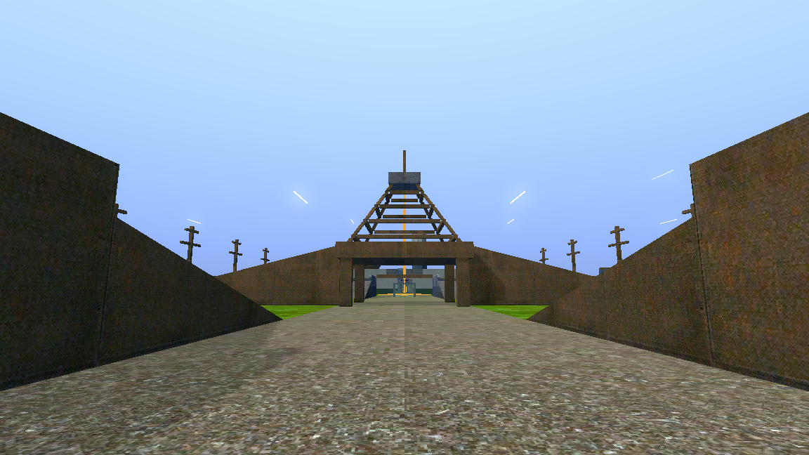 | filter OFF — clean white-hot streaks |
| 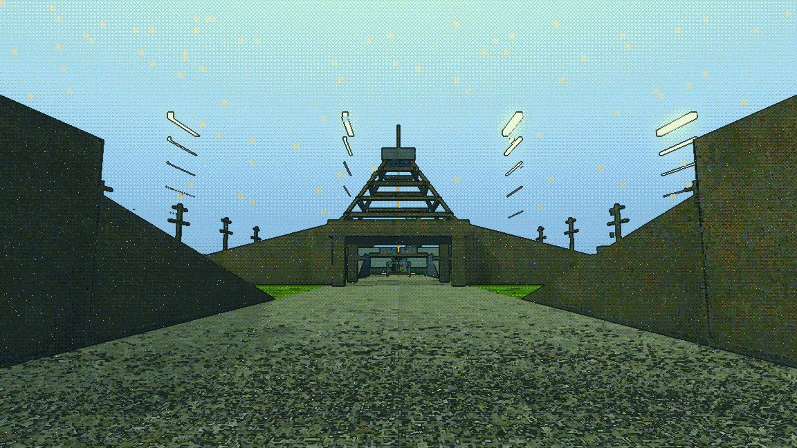 | filter ON — thin rows are dark slashes, the fat row survives |
| 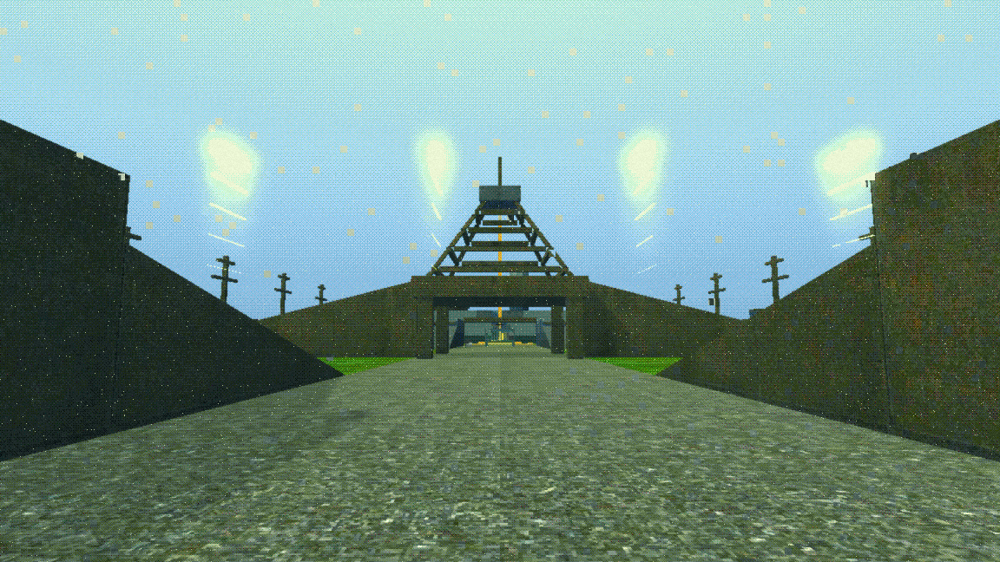 | filter ON, **edge pass only** switched off — every row bright again |

The third image is the proof. Same filter, same luma and chroma quantisation,
same dither, `edge_strength = 0`. Everything comes back. It is the edge pass
and nothing else.

### The threshold, measured

`impact_26_thickness_ladder.png` is five bursts identical in speed, length,
colour and brightness, differing **only in cross-section**, at 26 m:

| world width | apparent width | result |
|---|---|---|
| 0.02 m | ~0.8 px | black |
| 0.05 m | ~2 px | black |
| 0.10 m | ~4 px | black |
| 0.15 m | ~7 px | survives, with a dark rim |
| 0.20 m | ~8 px | survives |
| 0.40 m | ~16 px | bright white |

**The threshold is between 4 and 7 screen pixels.** Below it, hot = black.

### Soft edges do NOT fix it — my hypothesis, and it failed

The edge pass keys on per-pixel luma *steps*, so fading the cross-section
should spread the contrast and drop every step under threshold. It does not:
`impact_27_soft_vs_hard.png` shows a 2 px streak with a soft profile is still
black, because **a 2 px streak has nothing to spread a ramp over** — the fade
lands inside one pixel and the step is the same step, only dimmer. Softness
buys nothing width has not already bought. Recorded so it is not re-tried.

### The fix: constant apparent width

Pixels are a function of range, so a fixed world calibre is legible at 10 m
and inverted at 60. Solve the width per round per frame from its distance to
the eye:

```gdscript
w = max(calibre, distance_to_eye * m_per_px_at_1m * FLOOR_PX)
```

One subtraction, one length and one max, inside a loop already touching every
slot. `tools/mock_impacts.gd` does this for tracers *and* sparks (sparks at
their physical 2.2 cm are under 2 px at 12 m and were completely invisible in
three successive renders — it read as the channel being switched off).

**This probably already affects the shipped tracers.** `tracer.tscn`'s mesh is
8.5 cm across; at 20 m that is ~3.4 px, under the threshold. Worth looking at
directly — I did not render the game's own tracer through the filter.

### What else this implies

Anything thin and hot in this game has the same problem: muzzle flashes, the
signal arc, laser designators, HUD-adjacent 3D elements. It is a project-wide
rendering rule, not an impacts question.

---

## 4 · The impact effects

Four channels, all pooled. `FREEZE` is **seconds since the last round landed**
— each picture is one instant, with the newest round's sparks hot and the whole
burst's pits on the wall.

### One round, 3.6 m — the clearest picture here

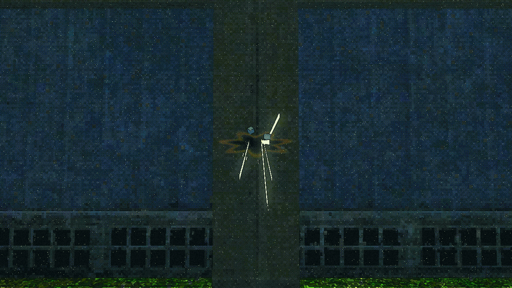

A dark pit with a hot amber rim fanning out of it, four white spark streaks
thrown down and out along the reflected vector, and two grey chips tumbling
off. It reads, and it survives the filter.

### The channels, separately

| | |
|---|---|
|  | **today** — the same wall, same burst, nothing |
|  | sparks only |
|  | scorch pits only |
|  | debris chips only |
| 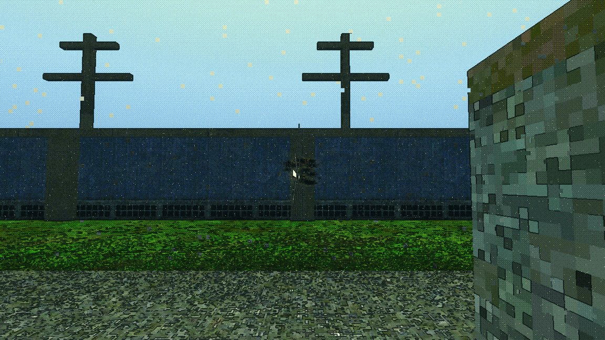 | all four |
| 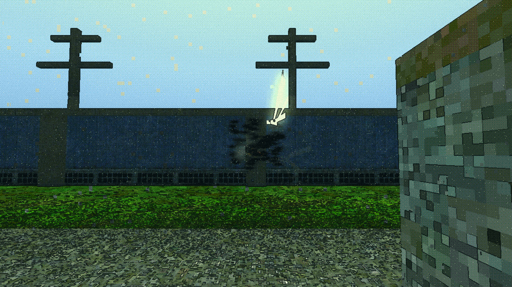 | 180 rounds — the room a long firefight leaves |

**Honest reading of these:** at 12 m the per-channel shots are weak. A burst
lands inside a 1.3 m patch and the pits merge into one smudge; the sparks are
a ~20 px knot. They are *there* and they are correct, but the close-up is the
one that makes the case. If the human wants to judge these, judge shot 06 and
the firefight shot; shots 02–05 mostly prove the channels exist.

### The three buckets, in a level with real terrain

| | |
|---|---|
| 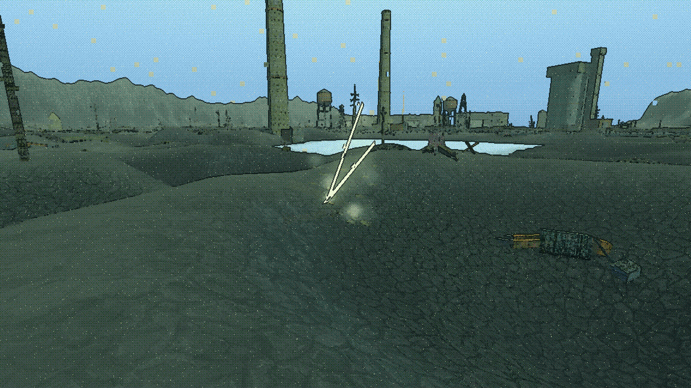 | TERRAIN — pale dust puffs, no chips |
| 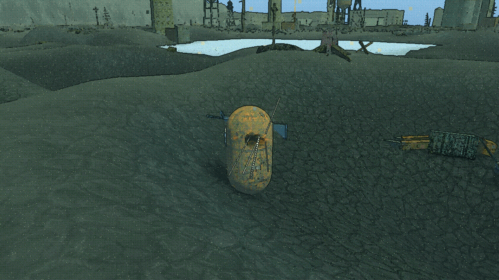 | ROBOT — wide hot spark fan, no chips, no dust |

### The penetration tell

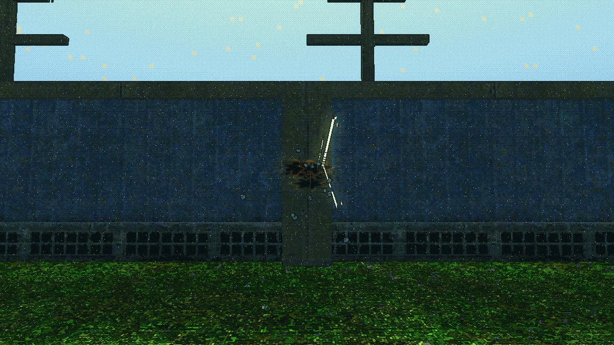

*Stopped* gets the full pit, spark fan and chips. *Through* gets a thinner
spark set and an **exit puff on the far side**.

**This is a mock-up of a mechanic that does not exist.** `_one_round` stops at
the first collider; nothing in the game penetrates anything. The visual
language is here so it can be judged, but shipping it means building
penetration first.

### The near miss

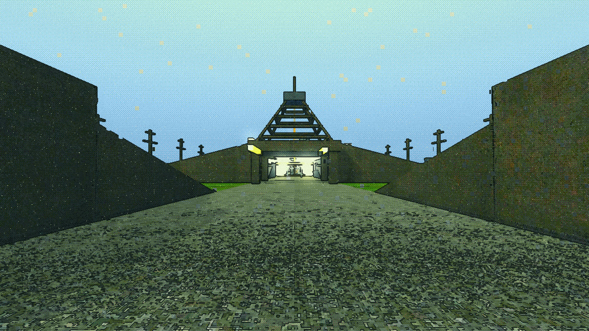

Rounds whipping past inside arm's reach and going on downrange.

**The crack is audio and cannot be photographed.** This is the half of the
event that can be. And see shot 24 below: a round coming *straight* at you has
no on-screen shape at all, which is precisely why this one has to be sound and
a HUD direction cue rather than a 3D effect.

---

## 5 · Tracers by calibre

### The weapon classes are the game's, not a guess

Read from `Character/weapon/ai-wep_*.tscn`. `fire_cooldown` is the **interval
inside a burst** (`enemy.gd:3059` re-arms `fire_time` from it per round), so it
is the cadence.

| class | cadence | damage | burst | range |
|---|---|---|---|---|
| squad automatic | 0.11 s | 18 | 10 | 85 m |
| heavy MG | 0.12 s | 22 | 14–26 | 105 m |
| machine gun | 0.13 s | 15 | 8–16 | 99 m |
| M4 rifle | 0.35 s | 30 | — | 80 m |
| autocannon | 0.50 s | 60 | 3 | 120 m |
| pistol | 0.55 s | 24 | — | 35 m |
| bolt | 0.80 s | 62 | 1 | 100 m |
| shotgun | 0.90 s | 70 (9 pellets) | — | 45 m |
| light cannon | 1.60 s | 48 | 1 | 85 m |
| marksman | 1.90 s | 48 | 1 | 130 m |
| recoilless | 4.50 s | 110 | projectile 34 m/s | 120 m |

### The autocannon is not the beaded chain

The brief guessed it would be. **The table says otherwise.** The autocannon
fires *three* rounds half a second apart for 60 damage — that is a thumper,
and it wants the single solid heavy streak the reference shows. The rapid-fire
weapons in this game are the **squad automatic, machine gun and heavy MG** at
0.11–0.13 s, and those are the chain.

### Emergent vs authored: emergent wins, and the first measure was wrong

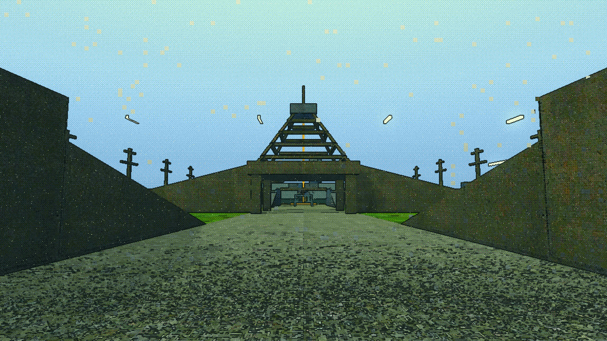

Top row: several short rounds in flight at the rapid class's own 0.11 s
cadence. Nothing authored. Bottom row: one long streak with a dash pattern cut
into it by the fragment shader.

**I asked the wrong question first.** My initial measure compared bead
*spacing* against the streak's own *length* and called anything wider than
three lengths "separate rounds". That is not what makes a chain read as a
chain. What makes a chain is **how many lit segments are in the air at once
along the line of fire**, and what fraction of that line is lit:

```
beads = range / (speed x cadence)        duty = streak length / (speed x cadence)

at 80 m:
  squad automatic 0.11s   10.4 m apart ->  7.7 beads, duty 0.15   A CHAIN
  machine gun 0.13s       12.4 m apart ->  6.5 beads, duty 0.13   A CHAIN
  heavy MG 0.12s          14.4 m apart ->  5.6 beads, duty 0.24   A CHAIN
  M4 rifle 0.35s          52.5 m apart ->  1.5 beads             one at a time
  autocannon 0.50s        85.0 m apart ->  0.9 beads             one at a time
```

**The coordinator's hypothesis is right.** Six to eight beads is exactly the
reference's look, and it falls out of fire rate and flight speed with **no
dashed-trail authoring at all**. The only knob is tracer speed, and even the
shipping 160 m/s gives 3.8–4.5 beads at 80 m.

It is also cheaper in the sense that matters: no authored asset, no second
shader path, no per-class trail. It costs *more live slots* (several short
rounds instead of one long one), and at ~0.0005 ms per tracer that is not a
cost. **Build the emergent one. The authored beaded spec in the tool exists
only to have something to compare against.**

### The vocabulary

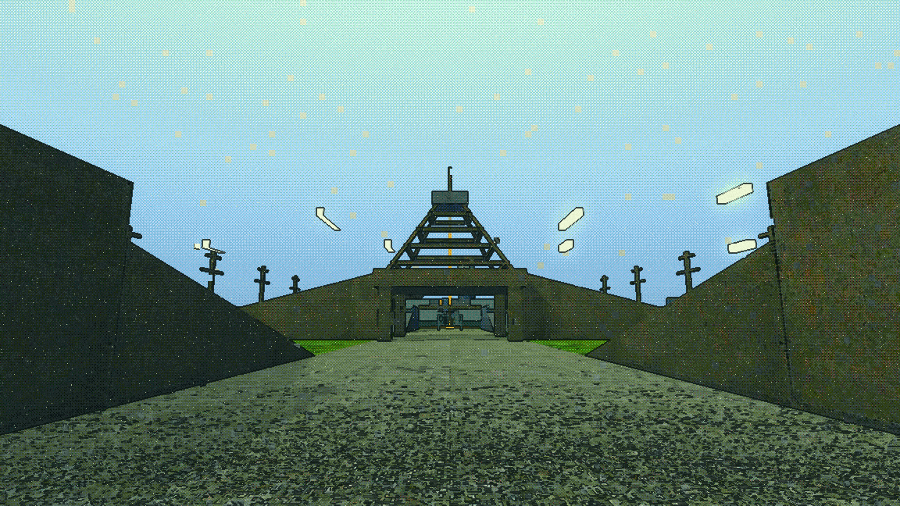

One row per class, each fired at its own cadence, caught as one instant. The
lengths separate cleanly — short sparse dashes for small arms, a denser train
for the MG, a long solid bar for the cannon. They carry a dark outline from
the edge pass, which honestly reads rather well: an ink-outlined streak is
consistent with how the rest of the game renders.

### A tracer flying away from you has no shape

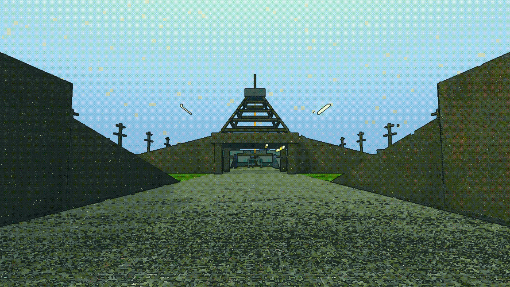

Same weapon, same cadence, twice: crossing the frame, and fired straight down
the camera's own axis. The second is a dot.

**So your own outgoing fire can never carry the vocabulary.** Only incoming
and flanking fire can — which is fine, because that is the half that matters:
the question a tracer answers is *what is shooting at me*.

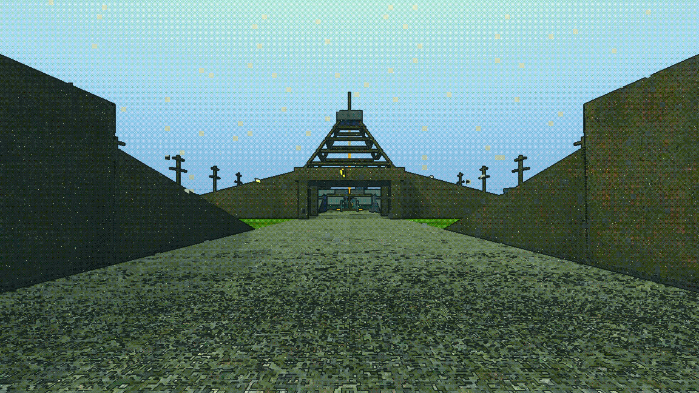

And this is the uncomfortable corollary: three shooters converging on the
camera at 1-in-5 produce **almost nothing on screen**. A round coming straight
at you is foreshortened to a point. **Incoming fire aimed at you is the least
legible case there is** — which is the single best argument in this document
for the near-miss crack being *audio plus a HUD bearing*, not a 3D effect.

### One in five

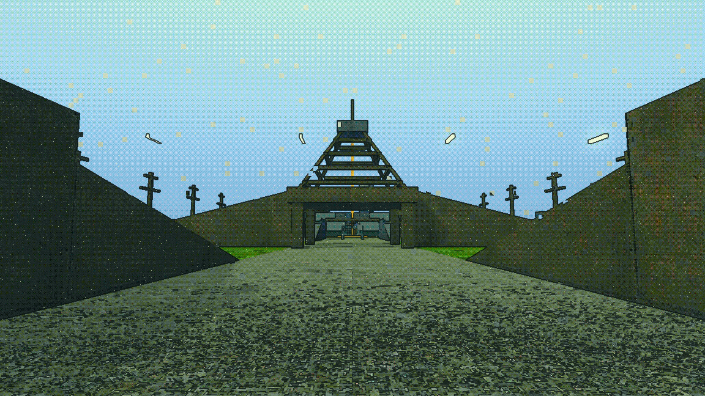

Top: every round tracered. Bottom: one in five, same burst, same cadence.
Sparse reads as a *stream of rounds*; full reads as a solid rod. Sparse is
also five times cheaper in live slots. **Take 1-in-5.**

### Faction colour does NOT survive — tested, and it fails

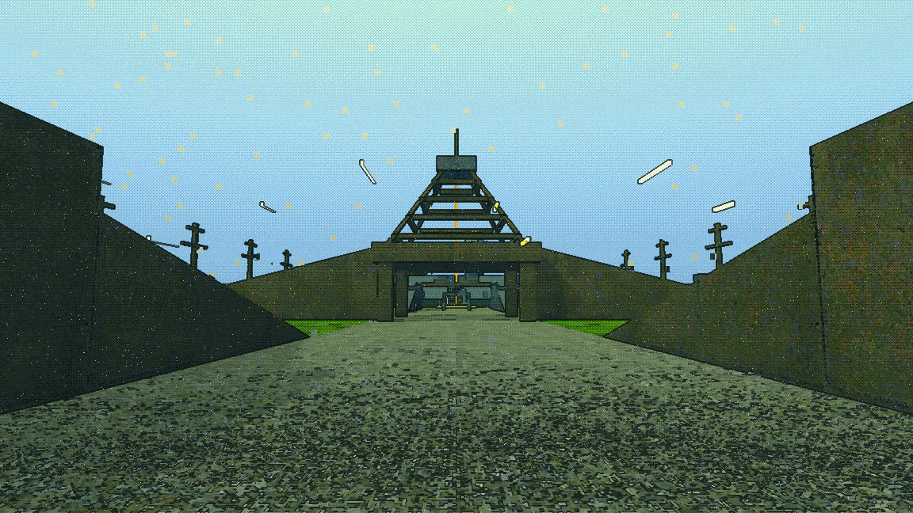

The same burst three times in the three `hud_palette.gd` values — adversary
amber `(0.91, 0.63, 0.23)`, home green `(0.64, 0.73, 0.44)`, Argus tyrian
`(0.69, 0.20, 0.47)`. **All three render as the same pale yellow-white.**

Two causes, and the second is the one that was not expected:

1. The filter quantises chroma to 5 levels at `saturation 0.9` and then mixes
   60% toward a shadow→mid→high ramp whose mid is itself green-cream. Home
   green has almost no chroma left relative to that ramp.
2. **More importantly, an additively-blended hot streak clips to white.** Hue
   cannot survive a channel that is already at 1.0. Tyrian is the worst case
   and is gone completely.

**Caveat, and it matters:** this was tested at *tracer brightness*. The
project's existing two-way split (incoming red / outgoing yellow-white in
`tracer.gd`) evidently does read, and `tracer.gd`'s own comment says why —
the two are *a hue apart*, not two shades of one. So colour works as a
**two-way, well-separated, not-clipped** signal. It does not work as a
three-way faction code on a hot streak. If faction identity on tracers is
wanted, it needs a dimmer body colour and only two or three maximally
separated hues, and it should be re-tested — I did not try a dimmed variant.

---

## 6 · The budget

Everything is pooled from the first line. Fixed-size ring buffers; a shot
**writes into slots it does not own** and the oldest occupant is overwritten.
There is no queue, no cull pass and no "too many effects" branch, because **a
ring buffer cannot overflow**.

### The pools

| channel | slots | life | per event |
|---|---|---|---|
| scorch pit | 192 | 14 s | 1 |
| spark | 480 | 0.22 s | 6 (2 on terrain) |
| chip | 160 | 1.1 s | 2 (brush only) |
| dust | 128 | 1.8 s | 1 on terrain, 1-in-8 elsewhere |
| tracer | 96 × 7 classes | ≤ 2.5 s | 1 per **fifth** round |

**1632 slots in 11 draw calls.** Per-class tracer pools so a machine gun
firing flat out cannot eat the slot a recoilless round needed.

### What it costs — measured, CPU time, no awaits

```
one impact      robot    0.0027 ms      terrain  0.0020 ms      brush  0.0034 ms
one tracer fired         0.0005 ms
one round, tracer + impact               0.0037 ms

the pool tick, EMPTY                     0.1141 ms   (= 1.0 awake robots)
the pool tick, FULLY SATURATED           0.4569 ms   (= 4.0 awake robots)
                                         = 2.7% of a 60 Hz frame

1.00 ms of headroom buys  280 rounds registered in a single frame
```

(Timed synchronously. Timing `await physics_frame` in headless measures the
16.67 ms tick rather than the work — that mistake has cost this project four
benchmark sweeps.)

### Does it survive Qamareen?

`MODE=rates`, against the measured 186 bodies:

```
 93 bodies shooting, sustained (45% duty of cyclic):
   squad automatic   ~380 rounds/s   240 live tracers every round,  48 at 1-in-5
   heavy MG          ~350 rounds/s   174 live tracers every round,  35 at 1-in-5
```

Worst realistic case: **~400 rounds/s = 6.7 rounds per 60 Hz frame = 0.025 ms
of registration.** The fixed tick dominates completely.

**The ceiling policy:** at 400 rounds/s the spark pool (480 slots, 6 per
impact, 0.22 s life) turns over every ~0.2 s, so the oldest sparks are
recycled a fraction early. That is invisible — a spark you were going to lose
in 40 ms. The pit pool (192, 14 s life) is the one that visibly wraps: beyond
~190 rounds the earliest holes vanish. `impact_08_after_the_firefight.png` is
180 rounds, just under it.

### The honest caveat on the tick

**0.46 ms is a constant, not a function of how hard the fight is** — the tick
walks every slot whether or not it holds anything. That is the design: the
frame cost cannot spike. The price is that a quiet level still pays 0.11 ms
for having the field in the scene. If that matters, a dense live-list would
scale with live count instead; the gap between 0.11 and 0.46 ms is what such a
rewrite is worth, and it is not much.

---

## 7 · What I would build, in order

1. **The near-miss crack.** Audio, positional, plus a HUD bearing tick.
   `suppress_along` already computes distance-to-segment for every round and
   already finds the player. It is a presentation layer on existing, correct
   arithmetic, it is the cheapest thing on this list, and it is the only one
   that makes being shot at *feel* like anything. It also gives the whole
   signal/suppression ladder its first visible output.
2. **Fix the apparent-width floor project-wide, and look at the shipped
   tracers through the filter.** Everything thin and hot in this game may be
   rendering black at range. This is a one-line change with a wide blast
   radius and it should be settled before any new effect is tuned.
3. **The impact field: pit + spark fan, three buckets.** One pooled node,
   wired into the four lines of `_one_round` that already have the hit point,
   the normal and the victim. Chips and dust after, on the same pool.
4. **Tracers at 1-in-5, emergent beading, five classes by length and width.**
   No authored dash trail. Drop the player's legacy per-frame raycast path and
   use `Tracer.launch()` like the AI already does.
5. **Not yet: faction-coloured tracers** — tested, does not survive.
   **Not yet: the penetration tell** — it is a picture of a mechanic that does
   not exist.

---

## 8 · What is NOT verified

- **Game feel and balance.** I ran it; I did not play it. Whether a spark fan
  is satisfying, whether 1-in-5 reads in motion, whether the dark edge-rim on
  a tracer is a look or a bug — those are the human's and nothing here
  substitutes.
- **Motion.** Every picture is frozen. Tracer legibility is a *moving*
  property and a still cannot settle it.
- **Audio.** Nothing was written, heard or budgeted. The near-miss crack —
  item 1, the thing I most recommend — is entirely unprototyped.
- **The shipped tracer through the filter.** Predicted to go dark at range by
  the same measurement; not rendered.
- **A dimmed faction-colour variant.** The three-way test failed at full
  brightness only.
- **GPU cost.** Everything measured here is CPU. 1632 additive, depth-write-
  disabled instances is a real fill-rate cost and nobody has looked at it.
- **Shots 02–05 are weak pictures.** The channels are correct but 12 m is too
  far to judge them; shot 06 is the one that shows the work.
