# SCREEN FEEDBACK — making the filter answer when you shoot well

**Status:** concept, nothing wired. Renders are real: the game's own shader,
the game's own uniform values, 1152 × 648, eye at 1.50 m, one camera, one
scene, one lighting setup across all eleven frames.

**Rendered by:** `tools/mock_filter.gd`

```bash
godot --audio-driver Dummy --path . --script res://tools/mock_filter.gd -- docs/concepts
```

Not headless, on purpose — `signal_filter.gdshader` samples
`hint_screen_texture`, and under `--headless` there is nothing to sample, so
every frame comes back flat and looks like proof.

---

## 1 · The asymmetry

The screen already reacts to being shot. `hud.gd` keeps `_damage_pulse`, adds
`damage_spike` 0.2 per hit, caps it at `damage_spike_cap` 0.3, decays it at
2.2/s, and adds it to signal loss to make the shader's `damage` uniform. That
uniform costs you, in the shader's own words, the ability to *make things out*:

| what `damage` drives | line |
|---|---|
| four-tap blur width `0.25 + damage * 1.6` | the smear |
| edge pass `edge_strength * (1.0 - damage * 0.65)` | silhouettes fade |
| packet loss `dropout * (1.0 + damage * 18.0)` | holes |
| macroblock displacement `block_glitch * (0.25 + damage * 2.5)` | tearing |

Nothing in the game moves that uniform when a shot of **yours** lands. So the
feed is a punishment channel with no reward channel: it flinches when you are
hit, and sits there when you fight well.

---

## 2 · The recommendation

**A negative spike. On a confirmed landed shot the filter CLARIFIES for about
250 ms: more tonal steps, harder silhouettes, less static.**

It wins for four reasons, in order of how much they matter.

1. **It is the same axis, run backwards.** It needs no new visual vocabulary.
   The player already knows what a degraded feed looks like, so a frame that is
   momentarily *better* than resting reads instantly and needs no teaching.
2. **It rewards with information, not with decoration.** A flash takes legibility
   away at the exact moment you are aiming. This hands it over. *Landing a shot
   makes the world legible* is a better loop than *landing a shot makes the
   screen go bright*, and it is a better loop specifically because it is useful.
3. **It costs nothing in the shader.** Every knob below is already a uniform
   that `hud.tscn` sets and `hud.gd` can write. No shader edit, no new
   full-screen pass, no new material.
4. **It cannot repeat the known failure.** The shader's comments record
   posterising luma *down* snapping a smooth sky into two flat bands that landed
   on different hues with a hard seam between them. This only ever moves luma
   steps *up*, which subdivides bands that already exist and can never create a
   seam.

### The numbers

An **independent** accumulator and an **independent** cap. Sharing `hud.gd`'s
would rebuild the known bug mirrored.

| | value | why |
|---|---|---|
| `clarity_spike` | 0.12 per landed shot | three landed shots to reach the cap |
| `clarity_cap` | **0.35** | see §4 |
| `clarity_decay` | 4.5 / s | twice `damage_spike_decay`. A flinch is a state; this is a flash |

With `k = clarity / clarity_cap`, as deltas on whatever `hud.tscn` says:

| uniform | scene value | at `k = 1` | effect |
|---|---|---|---|
| `luma_levels` | 10.0 | `+ 8.0 k` → 18 | tonal steps subdivide |
| `chroma_levels` | 5.0 | `+ 3.0 k` → 8 | colour stops stepping |
| `edge_strength` | 0.75 | `+ 0.50 k` → 1.25 | silhouettes snap |
| `contrast` | 1.12 | `+ 0.08 k` | |
| `saturation` | 0.90 | `+ 0.10 k` | |
| `grain` | 0.05 | `× (1 − 0.85 k)` | static drops |
| `dropout` | 0.003 | `× (1 − k)` | holes close |
| `block_glitch` | 0.12 | `× (1 − 0.90 k)` | tearing stops |

**Not touched, deliberately:** `signal_height`, `chroma_divisor`, and all three
palette tints. The shader's comments record three separate attempts at
degrading through block size and palette banding, all of which read as a
changed art direction rather than a changed signal. Clarifying has the same
hazard in the other direction — grow the grid or move the tints when a shot
lands and the world changes colour when you shoot, which is a bug wearing a
feature's clothes.

---

## 3 · The renders

All eleven are the same camera, the same scene, the same light. A Soldier
stands left of the gantry, a Bulwark right of it, both 14 m out.

### What they already have

| | |
|---|---|
| **Resting.** `damage = 0`. Dithered stipple across sky and wall, a scatter of cream dropout specks, soft edges on the Bulwark. This is the game. | 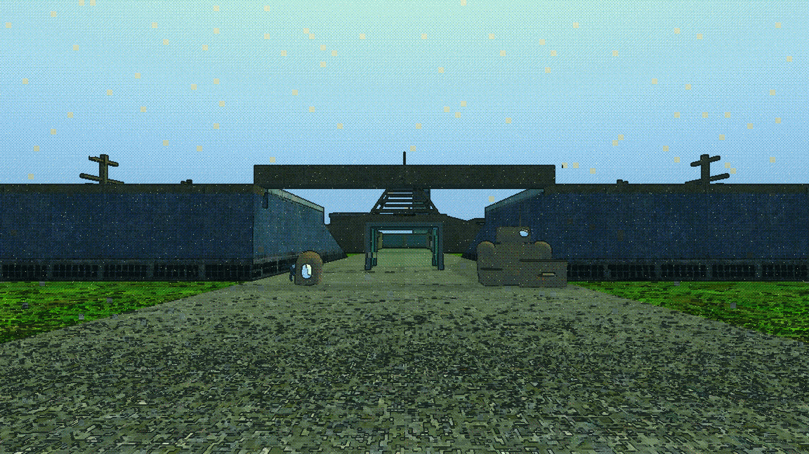 |
| **Suppressed.** `damage = 0.55` from signal loss alone. Heavy snow, the mast silhouettes smear into doubles, the Bulwark's outline goes mushy. | 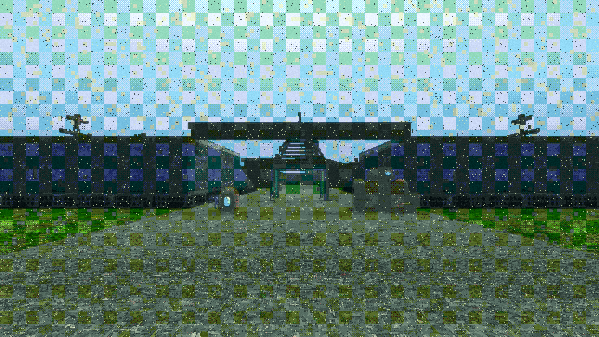 |
| **Being hit**, at the existing cap. `damage = 0.30`. Same kind of degradation, less of it. Note that the existing feedback has exactly **one** axis — "worse" — which is why running it backwards needs no new language. | 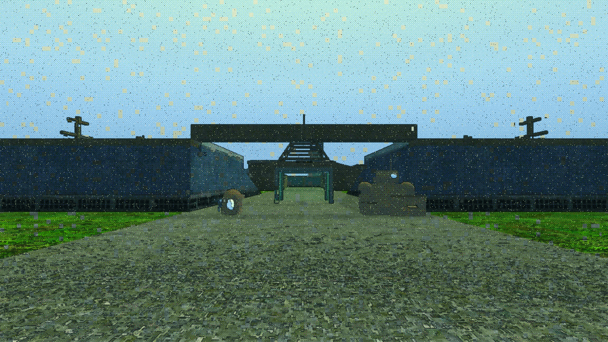 |

### The proposal

| | |
|---|---|
| **A landed shot, half strength** — `clarity = 0.175`, roughly the decay tail 80 ms later. Bulwark outline already crisp, ground tracery stronger, grass greener. The sky still carries its stipple and specks. | 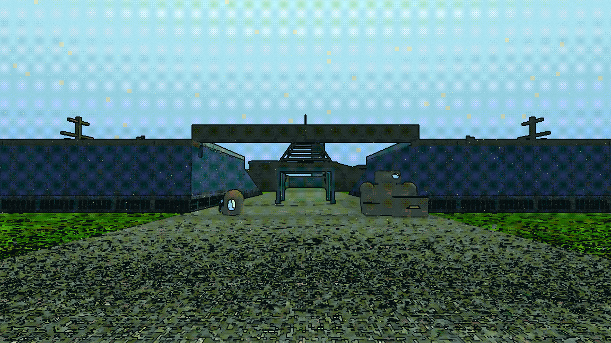 |
| **A landed shot, at the cap** — `clarity = 0.35`, from rest. The stipple is gone, the sky is a clean gradient, almost all the dropout specks have closed, the gantry struts and the Bulwark's hull have hard black outlines, the blue and the green are deeper. It reads immediately and it reads as *resolution*, not as *brightness*. | 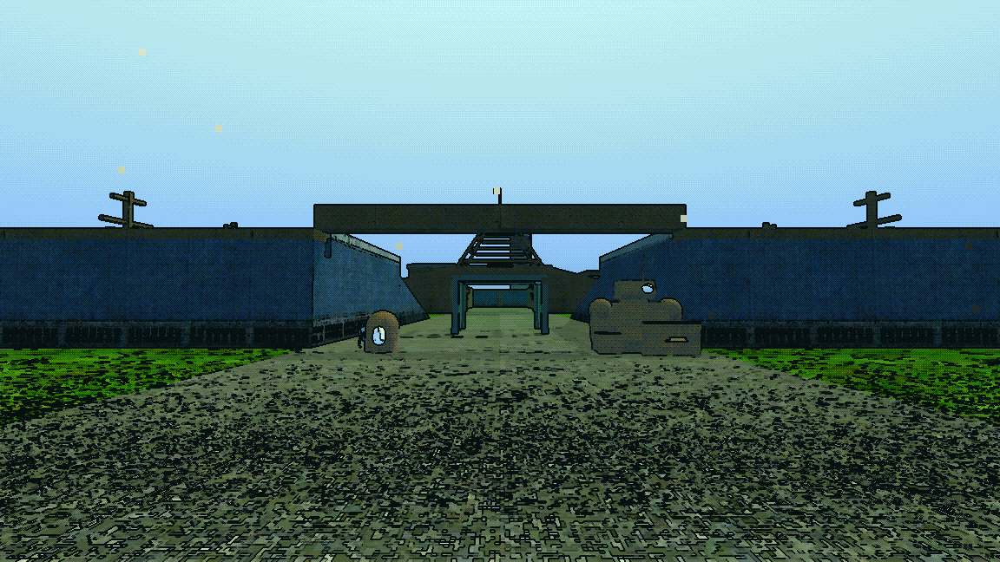 |
| **THE CASE THAT MATTERS** — suppressed to 0.55 **and** landing shots at the cap. Against the suppressed frame above: the snow is gone, the masts are single crisp silhouettes, the Bulwark has an outline again. The residual blur stays, so it still reads as a bad link momentarily punching through rather than as a healed one. This is the loop. | 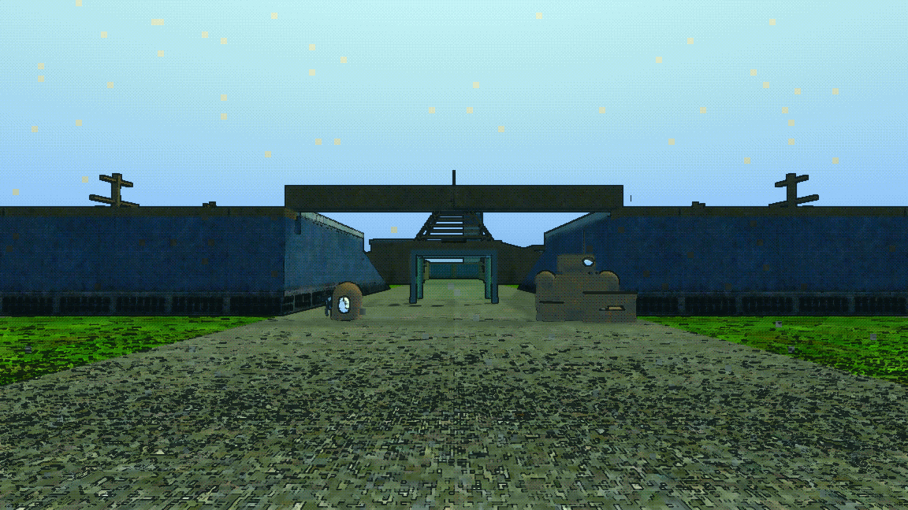 |

A cheap corroboration that the clarify is really removing noise rather than
just looking different: PNG is lossless, so file size tracks image entropy.
Resting is **1.92 MB**, the same frame at the clarity cap is **1.21 MB** — 37%
less. The overcooked frame is **0.62 MB**, which is the number saying the
quantisation has gone.

### Worst case

| | |
|---|---|
| **Everything at once.** Signal loss 0.55 + incoming spike 0.30, clamped to `damage_ceiling` 0.85, with outgoing clarity simultaneously at its cap. Soft — the blur at `damage = 0.85` is a real smear — but readable: no static field, nothing blown out, every object still locatable. The cap holds. | 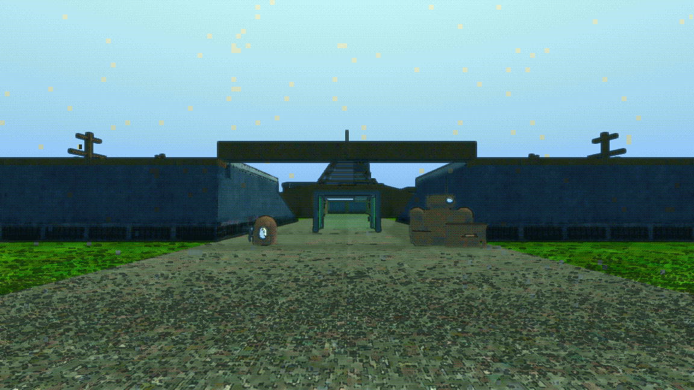 |

Note what this frame also shows: clarity **cannot cancel a dying link**. At
`damage = 0.85` the edge pass is already multiplied by 0.45, so the edge boost
has little left to lift. That is correct. Shooting well should buy you a
readable frame, not immunity.

### Why 0.35 and not more

| | |
|---|---|
| **Overcooked** — `luma_levels` 24, `edge_strength` 1.6, saturation +0.35. The sky is now a smooth continuous gradient: the quantisation has gone entirely, and this is no longer a compressed video feed, it is an ordinary 3D render with a green grade. The ground has turned to harsh black crosshatch. **The effect must never leave the game's look**, and this is where that boundary is. | 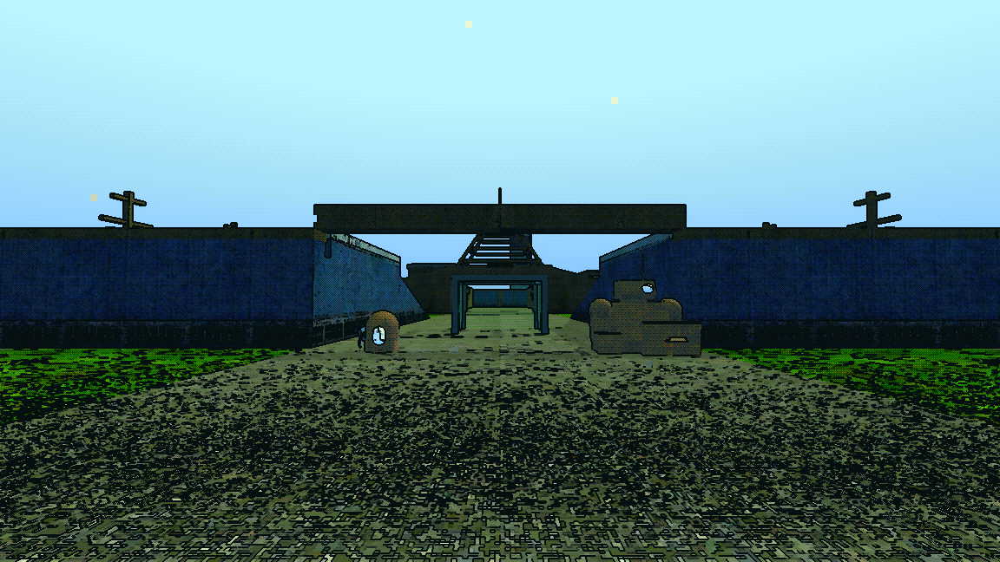 |

---

## 4 · The cap, and the burst that sets it

`damage_spike_cap`'s comment records three rounds arriving on one frame pinning
the uniform at 1.0 and the screen going to unreadable static — photographed,
and an ordinary burst rather than an edge case. Any outgoing effect needs its
own independent cap or it rebuilds that bug mirrored.

**Outgoing fire is denser than incoming, not sparser.** The fastest thing the
player can hold the trigger on is `pistol_hud_weapon.tscn` at `FIRE_RATE =
0.015` — **66.7 rounds a second, more than one round per 60 Hz physics frame.**

One second of held trigger with every round landing, integrated at 60 Hz:

```
     t   landed    clarity  uncapped would be
 0.02s        1      0.045  0.04
 0.18s       12      0.275  0.61
 0.35s       23      0.275  1.19
 0.52s       34      0.275  1.75
 0.68s       45      0.275  2.32
 0.85s       56      0.275  2.89
 1.02s       67      0.275  3.46
```

It saturates at the cap and stays there — the 0.275 is the cap less one frame
of decay. Uncapped it reaches **3.46**, which would drive `luma_levels` to 38
(past the shader's 32-step range), `edge_strength` to 2.5 (past its 2.0 range)
and saturation to 1.25. That is the mirror of the incoming bug exactly.

**A shotgun is not nine hits.** `hud_weapon_template.gd` already lands the
per-shot bonus on the centre round only (`struck`) and runs one suppression
pass per shot, with a comment saying explicitly that a shotgun must not land
the bonus nine times over. **The clarity spike belongs on that same hook** — in
`_fire`, once per shot, beside the suppression pass — and not in `_one_round`.
Put it in `_one_round` and `pellets = 9` becomes nine spikes on one frame,
which is three times worse than the incoming case the existing cap was written
for.

---

## 5 · The alternatives, and why they lose

### A · A single-frame bloom on a kill, scaled to target size

| Soldier, ×1.00 | Bulwark, ×1.35 |
|---|---|
| 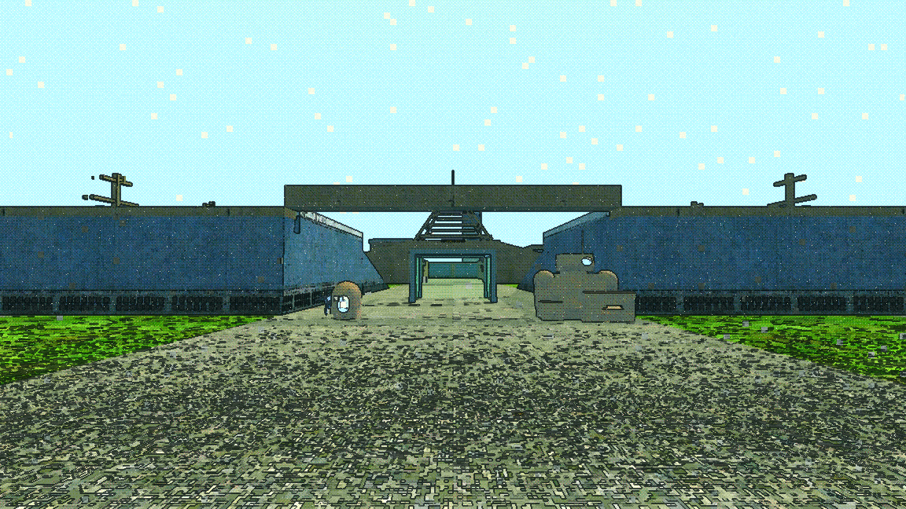 | 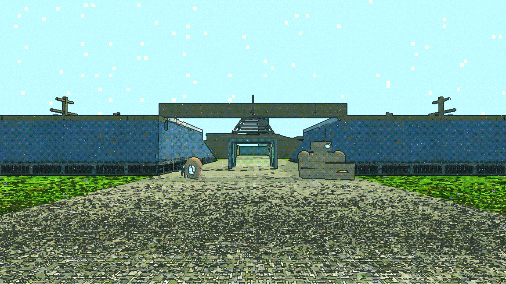 |

Measured in the frame rather than typed: Soldier 2.00 m, Bulwark 2.70 m, so the
honest scale between them is 1.35.

**It loses on two counts, both visible above.**

1. **The size scaling does not read.** Put those two frames side by side. The
   difference between a Soldier's bloom and a Bulwark's is not something a
   player will see in one frame of a firefight, because 1.35× on a global
   exposure lift is nearly nothing. To make it read you would have to make the
   *small* one weak enough to be invisible or the *large* one strong enough to
   blind — and the chassis heights in this game simply are not far enough apart
   for a brightness ramp to carry the distinction.
2. **It is global, and it looks it.** Nothing about the bloom is anchored to
   the thing that died. The whole frame lifts, the sky washes toward white and
   the shadows come up: it reads as the sun coming out, not as a Bulwark
   falling over. It also walks straight into the washed-out look the shader's
   own comments say was removed on purpose.

If a kill should feel bigger than a hit, **make it a deeper and longer clarify**
— a kill spends 0.30 against a hit's 0.12 and decays at 2.5 instead of 4.5, so
the clarity holds for most of a second. One vocabulary at two volumes beats a
second competing effect, and duration is a channel brightness does not have.

### B · An e-kill as a colour shift rather than a brightness spike

| |
|---|
| 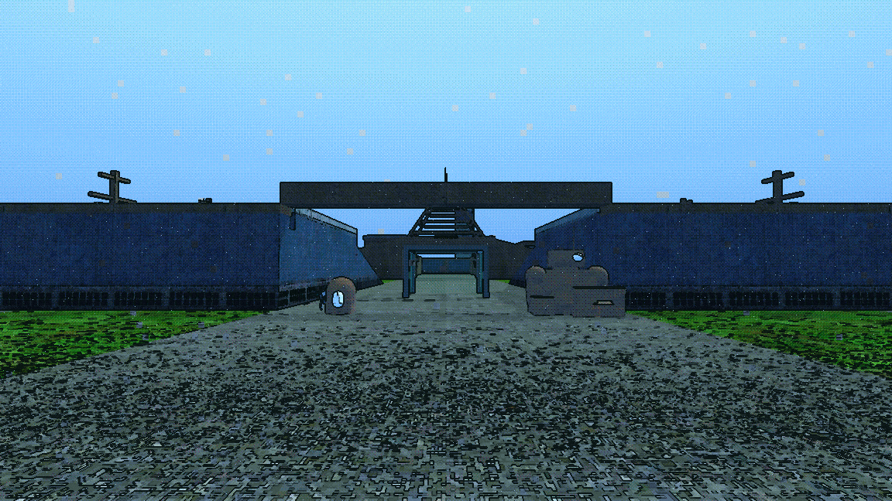 |

This does work as a *signal*: against the warm green-and-cream of the clarify
frame, the cold blue grade is distinguishable at the edge of vision without
either being brighter. Grass goes grey-green, stone goes cold, the sky cools.

**But it should not be its own mechanic, because it does not need to be.** The
clarify frame (`05`) and this one are already two clearly different frames. So
the cheap version of "the two death types are distinguishable peripherally" is:
*both deaths are a clarify; an e-kill's clarify carries a cold tint.* Same
accumulator, same cap, one extra lerp on the palette.

**And that tint is the one thing here that deserves a second look before it
ships.** The shader is emphatic — *"DAMAGE TOUCHES NO COLOUR. NONE."* — and the
mechanism that produced its worst recorded failure was neighbouring quantised
bands landing on different points of the `palette()` ramp. Moving both tints
coherently, as here, is safe; moving one is not. Keep the shift small, keep it
on the clarify's own decay so it is never up for long, and treat the tints as a
pair.

---

## 6 · Implementation notes

**One write, not two.** `_apply_damage_uniform()` already writes `grain`,
`dropout` and `block_glitch` as `base × Settings display.screen_noise ×
(1 + _damage_pulse × 1.2)`. The clarity factor multiplies the *same* three
uniforms. If a second function writes them, whichever ran last that frame wins
and the result is a flicker that will look like a renderer bug. **Fold the
clarity factor into `_apply_damage_uniform()`** and call that one function from
both paths.

**Read `hud.tscn`, never the shader defaults.** They differ today in three
places that all matter to this effect: `palette_strength` 0.60 vs 0.55,
`signal_fps` **8.0 vs 15.0**, and `dropout` **0.003 vs 0.012** — four times the
packet loss, which is most of what the clarify is removing. `mock_filter.gd`
reads the material out of the scene's `SceneState` and expresses every variant
as a delta, so retuning `hud.tscn` retunes these pictures too.

**Respect the SCREEN NOISE option.** A player who has turned noise down must
not get a bigger clarify out of it than someone who left it up — the three
noise uniforms are already scaled by the option, so the multiplicative form
above is the right one. The `luma_levels` / `edge_strength` side is not an
option and does not need scaling.

**Where the hook goes:** `hud_weapon_template.gd` `_fire()`, next to the
`suppress_along` call, gated on `struck != null`. That is already the
"this shot connected, once" fact the file computes.

---

## 7 · What this document does not establish

- **Whether it feels good.** These are pictures of single frames. The effect is
  a 250 ms transient and nothing here shows it moving, let alone shows whether
  it is satisfying, distracting, or invisible in a real firefight. That
  judgement is the human's and was not made here.
- **Whether 250 ms is the right duration.** The decay rate is reasoned from
  `damage_spike_decay`, not tested.
- **Whether it survives a crowded frame.** One Soldier and one Bulwark on an
  empty causeway is a clean test. A Qamareen-scale fight with smoke, tracers
  and muzzle flashes in frame may swamp it.
- **Cost.** Eight `set_shader_parameter` calls on a frame where a shot landed.
  Not measured.
